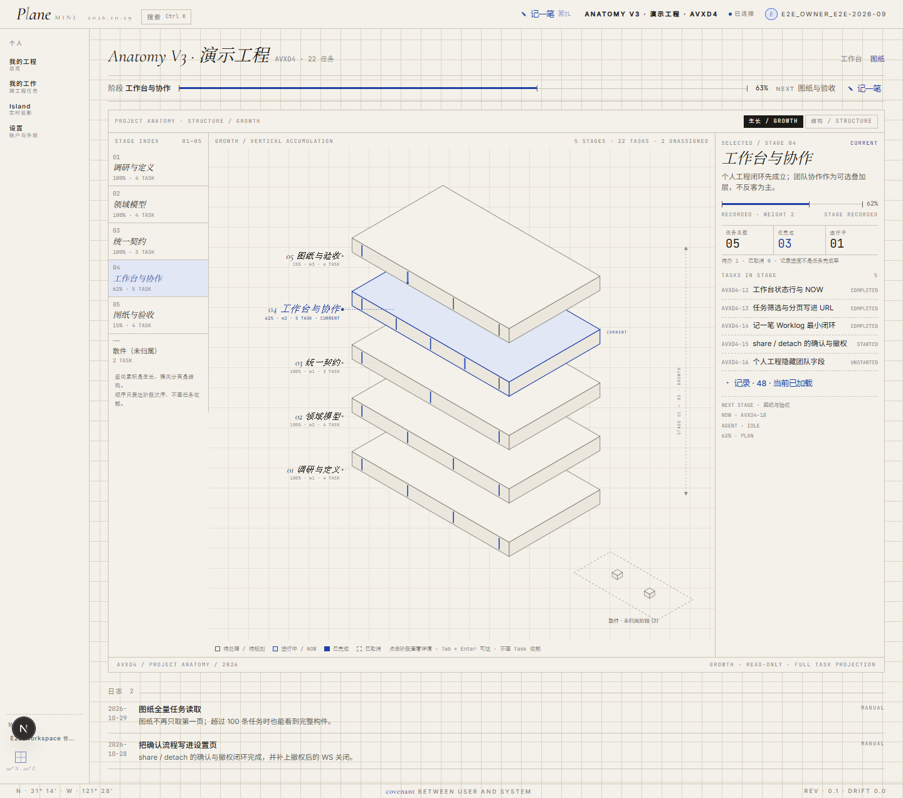
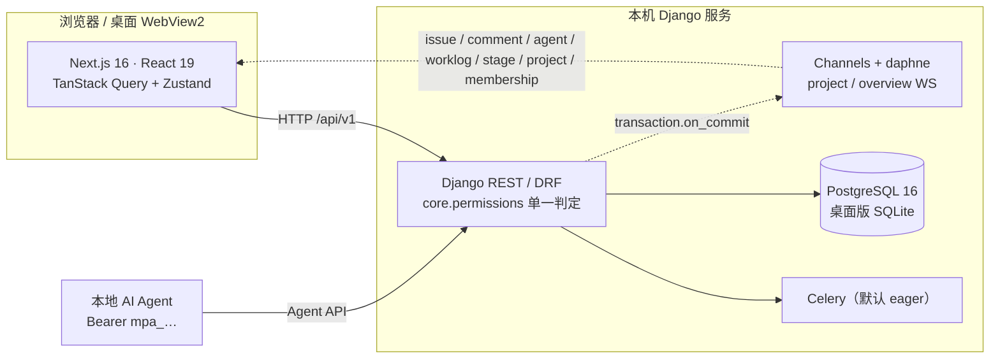

# Mini Plane

> **本地运行的个人工程管理系统。** 前端、后端、数据库都在你自己的机器上，数据不出本机。
> 双击一个图标就是一个原生窗口应用，不装 PostgreSQL，不联网也能用（除 AI Agent 功能外）。

<p align="center">
  
  
  
  
  
  
  
  
</p>

<p align="center">
  <a href="#5-快速开始">快速开始</a> ·
  <a href="#2-界面导览逐屏">界面导览</a> ·
  <a href="#3-功能清单">功能清单</a> ·
  <a href="#4-给-ai-agent-的接入">Agent</a> ·
  <a href="#6-架构">架构</a> ·
  <a href="#9-常见问题">FAQ</a>
</p>

<p align="center">
  
</p>

<p align="center">
  <sub>真实运行态截图 · 图纸（Anatomy V3 演示项目 AVXD4，5 Stage / 22 Task，演示数据，2026-10-29）；登录/抽屉/批量/Island 采集于 2026-10-22 至 10-25；界面以当前版本为准</sub>
</p>

<p align="center">
  <b>Python 3.12</b> · <b>Django 5.2 LTS</b> · <b>Next.js 16</b> · <b>React 19</b> · <b>TypeScript</b> · <b>Tailwind v4</b> · <b>Channels/WebSocket</b> · <b>pywebview</b><br>
  <b>后端 406</b> 用例 · <b>前端 175</b> 单测 · <b>39</b> 个浏览器 E2E（+setup 40）· <b>CI 三 job</b>
</p>

---

## 目录

- [1. 这是什么](#1-这是什么)
- [2. 界面导览（逐屏）](#2-界面导览逐屏)
- [3. 功能清单](#3-功能清单)
- [4. 给 AI Agent 的接入](#4-给-ai-agent-的接入)
- [5. 快速开始](#5-快速开始)
- [6. 架构](#6-架构)
- [7. 测试与质量](#7-测试与质量)
- [8. 设计语言](#8-设计语言)
- [9. 常见问题](#9-常见问题)
- [10. 路线图](#10-路线图)
- [11. 文档索引](#11-文档索引)

---

## 1. 这是什么

它最初是「仿 [Plane](https://github.com/makeplane/plane) 的迷你项目管理软件」。做到一半改了主意：

> **大多数人不是来「排期」的，是来「记住我今天把工程推到哪儿了」的。**

于是产品重构成两层——**但没有推倒重来**，底层（认证 / 权限 / 任务 / 评论 / 动态 / 实时 / 桌面 / 测试）全部复用，只把「产品中心」从**任务**移到**工程**：

```text
                         Mini Plane
                              │
              ┌───────────────┴───────────────┐
              │                               │
         MY ENGINEERING                 WORKSPACE
              │                               │
     我的工程总览 / Island                    │
              │                          工作区 · 成员 · 角色
             Plan                             │
              │                            Project
            Stages                            │
              │                             Task
             Task                        Comment · Activity
              │                          Realtime
           Worklog
              │
        Agent Sync
```

三层产品信条（贯穿全部代码与文档）：

| # | 信条 | 含义 |
|---|------|------|
| 1 | **Task 是计划，Worklog 是证据** | 任务写"打算做"，工程日志写"实际做了什么、结论如何"。这是与 Todoist / Linear 一类产品最本质的区别 |
| 2 | **百分比是辅助，阶段与 NOW 才是主信息** | 所以 Island 上最显眼的是「当前阶段 / NOW / STEP / HOW / NEXT / DONE」，百分比只占一行 |
| 3 | **Worklog 是结构化索引，不替代原始笔记** | 手写 Worklog 先记录事实；Markdown → Worklog 自动导入仍在路线图中，不会假装已经支持 |

**形态**：本地运行的单机软件。服务只绑 `127.0.0.1`、DEBUG 关闭、SECRET_KEY 首跑随机生成并存本机、桌面版用内嵌 SQLite（无需安装数据库）。

---

## 2. 界面导览（逐屏）

界面为中文，衬线大标题按设计语言保留英文。以下截图均来自**真实运行态**：登录、任务抽屉、批量操作、Island 来自本机真实账户与真实项目；工程台/图纸来自 Anatomy V3 演示项目 AVXD4（真实运行，但数据为演示数据，2026-10-29）。

### 2.1 进入 —— 记住"上次是谁"

<p align="center">
  
</p>

**昵称优先的免密入口**：输入昵称即可开始（本地单机版不该在第一次打开时逼你注册），密码与邮箱可在设置里自助绑定。昵称未注册会自动创建免密账户；也可以访问 `/register` 显式注册。

若本机已有账户，登录页会**直接显示该账户的用户名与头像，点一下就进**：

| 情况 | 行为 |
|------|------|
| 免密账户（默认） | 直接进入 |
| 设过密码 | 落到密码步，昵称已填好，只需输密码 |
| 账户已被删除 | 清掉记忆并提示换昵称 |

会话 cookie 跨启动保留，所以**重开应用免登录**。

### 2.2 我的工程（首页 `/`）

跨项目聚合视图，不再以「工作区列表」开头。首页是**行式工程索引**，不是卡片墙：

- **继续**：列出有 NOW 任务的工程，整行可点，直达任务抽屉；
- **工程**：每行显示标识符、名称、当前阶段、阶段进度、NOW、待办/完成数、最近活动与 `AGENT·RUNNING`；
- 列表末尾的空白横线就是**新建工程**入口：只填名称，标识符自动生成；
- 没有工程时是「初见面」：一句话 + 一条手写横线，全程不出现 Workspace、成员、角色。

`/projects/mine/` 由**一条 SQL 聚合**返回（correlated subquery + Coalesce + Exists），无 N+1。

### 2.3 左侧竖栏：个人四项 + 协作区

导航不是「个人 ⇄ 团队」切换，而是**常驻个人入口 + 底部按需出现的协作区**：

- 个人四项始终存在：**我的工程 / 我的工作 / Island / 设置**；
- 只有你确实属于某个 Workspace 时，底部才出现虚线「协作」区，列出工作区与角色；
- 没有工作区时整块隐藏，个人路径不出现团队噪音；
- 宽度恒定（`w-44`），主内容区不因切层抖动；
- 顶栏保留「搜索（Ctrl/⌘ K）」与「✎ 记一笔（Ctrl/⌘ Shift L）」。

**为什么不做顶栏切换**：团队是附加能力，不是与个人对等的第二套首页；把协作入口降级到侧栏底部，个人工程始终是默认起点。

### 2.4 项目页 —— Global Plan / Stage / Worklog / Task 一屏

项目页分「工作台 / 图纸」两种视图，共用同一条状态行，一屏读完"这个工程进行到哪了"：

- **状态行**：当前 Stage、阶段加权进度、NEXT、`AGENT·RUNNING`、`✎ 记一笔`；
- **工作台**：任务主区（状态 chips + 搜索 + 分页 + 就地新建）→ 路线（只读；点「调整」才出现进度输入与加阶段）→ 日志；
- **图纸**：Anatomy V3 的工程图纸对象（生长 / 结构双视图、全量 Task、固定索引与详情），详见 §2.8；
- **设置**：改名 / 改标识符 / 删除工程；团队工程可「脱离协作」，个人工程可「加入团队协作」；
- 新建项目自动预置五状态：`Backlog → Todo → In Progress → Done → Cancelled`；
- 进度不是单一百分比，而有 Plan 时为 `Σ(阶段权重 × 阶段进度) / Σ权重`，无 Plan 时回退任务完成率，并由 `progress_source` 显式标注。

### 2.5 任务列表 —— 筛选即 URL

当前工作台直接暴露的是个人流程最常用的子集：

- 状态筛选 chips（全部 / 待规划 / 待办 / 进行中 / 已完成 / 已取消，带真实计数）；
- 标题搜索与分页（`per_page=100` + `page` 写进 URL）；
- 行内显示标识符、状态名、标签、优先级与所属阶段；勾选后出现批量操作条；
- **筛选即 URL**：复制链接给别人会看到同一视图；非法参数被静默丢弃而不是报错。

后端 API 还支持指派人 / 标签 / 排序等过滤参数；当前 UI 刻意只暴露最常用的一组，避免把工作台做成筛选器面板。

### 2.6 任务抽屉 —— 动态审计 + 评论对话

<p align="center">
  
  &nbsp;&nbsp;
  
</p>

同一个抽屉里三个页签，两个列表**顺序相反是故意的**：动态（Activity）**倒序**——审计要看"最新发生了什么"；评论（Comments）**正序**——评论是对话；关联（Refs）展示相关引用。

- 字段**就地编辑**：状态 / 优先级 / 标签；团队工程额外有指派人，个人工程隐藏该字段；
- 乐观更新、失败自动回滚；
- 动态记录"谁在何时把什么改成了什么"（含可显示的旧值/新值，不是 UUID）；
- 评论作者可以编辑/删除自己的；项目 Admin 可以管理他人评论，普通 Member 不行；
- 改动会**产生活动留痕**，因此前端写操作会同时失效活动缓存。

### 2.7 批量操作

<p align="center">
  
</p>

勾选多行 → 底部浮出操作条：改状态 / 优先级 / 指派（团队工程）/ 标签（覆盖式，走异步 JobRun）/ 删除。状态、优先级、指派、删除逐条下发，**部分失败如实汇报**并支持「重试失败项」；个人工程隐藏负责人批量操作。

### 2.8 图纸视图 —— Anatomy V3

工程台的「工作台 / 图纸」开关切到同一项目的图纸视图。它不是装饰性插画，而是由真实任务、阶段与活动生成的确定性 SVG 对象（顶部主图即该视图）：

- **生长 / 结构双视图**：生长视图旧下新上、大图 + 纵向滑轨；结构视图左侧 ghost 整体 + 右侧爆炸 Stage 模块，虚线回连原始层位（只表示位置，不表示依赖）；
- **固定三栏**：左侧 Stage Index（顺序、记录进度、任务数），中间主图，右侧选中 Stage 详情；
- **全量 Task**：图纸分页读取全部任务并去重，超过第一页也不会漏构件；未取完时明确标注 partial；
- **散件托盘**：`stage=null` 的 Task 不隐藏、不羞辱，集中显示在中性托盘里；
- **NEW / UPD 痕迹**：页面挂载后真实发生的新增/状态变化以圆/菱形标记出现，只消费 `issue.*` 活动；
- **记录浏览**：Worklog 与 Activity 分栏只读浏览（当前已加载）；明确声明**没有快照就不提供历史回放**；
- **安全与可访问**：文本由 React JSX 渲染，不拼 SVG/HTML 字符串；Stage / Task 支持 Tab + Enter 与显式 SVG 焦点环，尊重 `prefers-reduced-motion`；
- **密度与上限**：视觉上每 Stage 最多画 14 条生长任务线 / 12 个结构立方体，超出显示 `+N`；计数与详情仍按全量 Task 计算。

### 2.9 团队层（工作区 · 成员 · 角色）

团队能力完整保留，只是从"产品中心"降级为"协作基础设施"：

- **/workspaces**：列出我加入的工作区、角色徽标；创建新工作区后创建者自动 ADMIN；
- **工作区首页**：最近工程、成员条、Admin 可见的成员/设置入口；团队工程列表走统一 Project 查询；
- **成员管理**：按邮箱添加、改角色（管理员/成员/只读）、移除；owner 不可移除、至少保留一位 Admin；
- **团队工程**：在工作区里新建工程（显式 `workspace_id`），或在个人工程设置里「加入团队协作」；
- **共享 / 脱离**：仅 owner 发起，输入确认；脱离会清空 ProjectMember、转为私人工程并广播撤权；
- **删除守卫**：工作区仍有工程时拒绝删除；前端显示后端解释，避免误以为会级联清空；
- **角色优先级**：owner 恒 ADMIN；ProjectMember 显式 override 优先；非项目成员时 WS Admin→ADMIN、其他 WS 成员→VIEWER。

### 2.10 Engineering Island —— 单窗两态「工程浮页」（V3）

**Island 是当前工程状态的实时投影。** V3 把它做成**一张可收起 / 展开 / 固定在桌面上的工程图纸**——原来的「触发把手窗口」已退役，**同一窗口只有两种形态**：

<p align="center">
  
  &nbsp;&nbsp;&nbsp;
  
</p>

<p align="center">
  <sub>左：<code>expanded</code> 520×420（默认，可缩放）· 右：<code>collapsed</code> 360×44（把手条，即入口）· 截图采集于 2026-10-22；当前版本已用真实 DONE / STEP / HOW 替换早期占位文案</sub>
</p>

| 形态 | 尺寸（DIP） | 内容 |
|---|---|---|
| `collapsed` | **360×44** | 把手条：标题 + 项目数 + LIVE 点 + 图钉 + 「展开」 |
| `expanded` | **520×420**（默认，可自由缩放） | 多项目总览（V2 一号位不变） |

**窗口永不隐藏**——收起态就是把手条本身，不是隐藏。两态经同一路由 `/island-panel` 承载，用 `?form=collapsed\|expanded` 区分首帧。

| 能力 | 说明 |
|------|------|
| 多项目总览 | 全部项目**同时可见**（面板内滚动），不翻页、不轮播 |
| 六问信息设计 | Progress / Stage / NOW / STEP / HOW / NEXT / DONE + AGENT 八项；缺数据**诚实占位**（"Agent 尚未报告步骤"），不用任务描述冒充 |
| DONE / STEP / HOW | DONE 优先真实完成标题（`recent_done`），没有才回退计数；STEP / HOW 只来自运行中 Session 的上报 |
| 单一实时连接 | `ws/engineering/overview/` **一条连接覆盖全部项目**（订阅协议 + 权限重校验 + 30s 心跳）；Agent 上报步骤（`session.progress`）→ 卡片**无刷新更新** |
| 诚实状态 | 页眉 **LIVE / 离线**——断线不虚报；90s 无帧自动重连，重连后以 REST 为事实来源重取 |
| 权限实时收敛 | 被移出项目 → 订阅**立即**退出该项目组（`membership.changed`），后续事件不再送达 |
| 视觉 | Island 专属圆角例外（外壳 26px / 卡片 14px / 单层淡阴影）；配色与动效仍守 Blueprint Editorial |

### 2.11 桌面 App 的窗口行为（V3 单窗两态）

桌面 App（pywebview + WebView2）有两个原生窗口：**主窗口**（完整应用）+ **Island 窗口**（同一窗口的两种形态）。行为全部持久化在 `runtime/desktop-config.json`，重启恢复：

| 行为 | 说明 |
|------|------|
| **首启默认展开** | 第一眼就看到 520×420 完整面板；你收起 / 固定过一次，之后按记住的模式启动 |
| **展开 / 收起** | 点把手条或 `Alt+I` → 250ms 平滑切换（15 步 × 16ms ease-out，左上锚定零漂移）；`Esc` 收起 |
| **图钉固定** | `pinned` 后面板常驻置顶，`Esc` 与关闭都不收起（防止误关）；取消固定**不自动收起** |
| **拖动 / 缩放** | 把手条整条是拖动区；展开态边缘热区缩放（`easy_drag` 在 Windows 后端未实现，故为 JS 桥接） |
| **位置记忆** | 拖动后位置、展开态尺寸都落盘；收起态**不**被 360×44 污染 |
| **退出干净** | 关掉主窗口 → Island、后端、前端**全部退出**，端口释放（运行期不 `destroy()`，避免工作线程互等挂死） |

### 2.12 记一笔：Worklog

顶栏 `✎ 记一笔` 或 `Ctrl/⌘ Shift L` 打开全局弹层：

| 字段 | 说明 |
|---|---|
| 工程 | 打开工程台时预选当前工程；多工程时可切换；没有工程时先建工程 |
| 标题 | 这一笔的短标题 |
| 完成了什么 | 实际做了什么、结果如何（必填） |
| 结论 / 下一步 / 阻塞 | 收进「补全」展开，按需填写 |
| 日期 | 默认今天；后端允许补记（API） |
| 来源 | `manual` / `agent` / `imported`，UI 手写为 `manual` |

`Ctrl/⌘ Enter` 提交，`Esc` 取消；未提交内容不会因为收起「补全」而丢失。

**Task 与 Worklog 不合并**：Task 表达计划，Worklog 表达证据。工程日志会出现在工程台「日志」区；Worklog 的改删权限为作者或项目 Admin（API），当前 UI 以记录/浏览为主。Agent 写入的 Worklog 会标记 `AGENT`，并触发 `worklog.created` 实时事件。

### 2.13 我的工作（/me/issues）

跨所有项目汇总属于你的任务，顶部三档：

| 范围 | 内容 |
|---|---|
| 全部 | 我能看到的、指派给我或我创建的任务 |
| 指派给我 | `assignee = 当前用户` |
| 我创建的 | `created_by = 当前用户` |

每行显示任务编号、标题、所属项目、优先级与状态色点；点击标题进入对应工程台。空态会说明任务何时会出现在这里。

### 2.14 设置与命令面板

`/me` 是个人设置页：

- **Identity**：昵称、邮箱、用户 ID、创建时间；
- **Appearance**：浅色 / 深色 / 跟随系统；显示大小「小 / 标准 / 大 / 特大」（本机持久化，首屏不闪白）；
- **Security**：可选设置/移除密码、绑定/修改邮箱（本地单机默认昵称免密）；
- **Agent Token**：创建、一次性查看明文、吊销；scope 白名单；
- **Session**：退出登录，销毁服务端会话并清空查询缓存。

`Ctrl/⌘ K` 或顶栏「搜索」唤起**命令面板**：输入即时过滤，`↑↓` 选择，`Enter` 打开，`Esc` 关闭。命令包含「我的工作 / 我的工程 / 设置 / 管理工作区」与每个可访问工作区。

| 快捷键 | 行为 |
|---|---|
| `Ctrl/⌘ K` | 打开命令面板 |
| `Ctrl/⌘ Shift L` | 全局「记一笔」 |
| `Ctrl/⌘ Enter` | 提交「记一笔」 |
| `Alt+I` | 桌面端展开 / 收起 Island |
| `Esc` | 关闭面板 / 抽屉 / 弹层 |

### 2.15 实时更新

- **项目通道**：打开工程台时建立一条项目 WebSocket；`issue.updated` / `comment.created` / `worklog.*` / `stage.updated` / `project.updated` 只失效对应 query keys；
- **Island 总览通道**：`/ws/engineering/overview/` 一条连接覆盖全部项目，订阅逐项回执；`connected` 不等于 LIVE，收到 `subscriptions` 才显示 LIVE；
- **权限实时收敛**：成员移除、角色变化、工程脱离协作或删除后，项目通道重查角色，失权主动 `close(4404)`；Island 退出无权项目组；
- **断线语义**：断线显示离线，不虚报 LIVE；重连后全量失效并重取 REST，事件本身不承载最终状态；
- **最新事件清单**：`issue.updated`、`comment.created`、`agent.session`、`worklog.created/updated/deleted`、`stage.updated`、`project.updated`、`membership.changed`。

> 详细协议与关闭码见 [`docs/api/08-realtime.md`](docs/api/08-realtime.md)。

---

## 3. 功能清单

| 模块 | 能力 | 状态 |
|------|------|------|
| **认证** | 昵称优先免密登录 · 记住上次账户一键进入 · 密码/邮箱自助绑定 · 会话持久化 | ✅ |
| **个人工程** | 跨项目行式索引 · NOW / NEXT / 今日日志 / Agent 运行态 · 单条 SQL 聚合 | ✅ |
| **项目** | 私人工程无需 Workspace · 团队工程显式 workspace_id · 标识符自动生成 · 预置五状态 | ✅ |
| **共享 / 脱离** | owner 显式发起 · 目标 WS 需 Member+ · 清空 ProjectMember · 缓存/实时撤权 · Activity 留痕 | ✅ |
| **Global Plan / Stage** | 阶段路线 · 权重 · 加权进度 · 当前/下一阶段 · 删 Stage 不删 Task/Worklog | ✅ |
| **Task** | 状态/优先级/标签 · 团队指派 · 就地编辑 · 乐观更新 · 搜索 · 分页 · 批量操作 | ✅ |
| **工程日志** | 标题/摘要/详情/结论/下一步/阻塞 · 关联 Stage · `MANUAL/AGENT/IMPORTED` 来源 · 作者/Admin 改删（API） | ✅ |
| **评论** | 对话流 · 作者可改删自己的 · 项目 Admin 可管理他人 · 普通 Member 不行 | ✅ |
| **动态审计** | 谁在何时改了什么 · 倒序时间线 · 与业务同事务 | ✅ |
| **批量操作** | 改状态/优先级/团队指派/标签（异步 JobRun）/删除 · 部分失败重试 | ✅ |
| **我的工作** | 跨项目全部 / 指派给我 / 我创建的 | ✅ |
| **命令面板 / 设置** | Ctrl/⌘ K · 主题/显示大小 · 密码/邮箱 · Agent Token · 登出 | ✅ |
| **图纸视图（Anatomy V3）** | 生长 / 结构双视图 · 全量 Task · 固定索引/详情 · 散件托盘 · NEW/UPD · 记录浏览 · 120 Task 实机回归 | ✅ |
| **实时协作** | WebSocket：issue / comment / agent / worklog / stage / project / membership；断线退避重连、撤权关闭 | ✅ |
| **Engineering Island** | 单窗两态（360×44 / 520×420）· 多项目总览（六问 + AGENT）· 单一 overview 连接 · LIVE/离线诚实 | ✅ |
| **桌面窗口（V3）** | 首启展开 · 折叠动画 · 图钉常驻 · 拖动/缩放 · 位置/尺寸持久化 · 关主窗即全退 | ✅ |
| **Agent Local API** | Token 一次性明文 · 5 个 scope · 项目 ID 定位 · `Idempotency-Key`（409/TTL）· Session/实时投影 | ✅ |
| **个人 / 协作导航** | 左侧个人四项常驻 · 协作区按需出现 · URL 即状态 · 无工作区时不出现团队噪音 | ✅ |
| **桌面 App** | pywebview + WebView2 · 内嵌 SQLite · 会话持久化 · 关窗停服 · PyInstaller 便携包 | ✅ |
| **工程化** | GitHub Actions 三 job · OpenAPI 快照 · ruff 全目录 · Playwright E2E · SQLite/Postgres 迁移 | ✅ |
| Markdown → Worklog 自动导入 | 解析 `docs/devlog/*.md` 写入 Worklog | ⏳ 二期 |
| Blocker 独立实体 | 目前是 Worklog 的字段，尚未升为一级概念 | ⏳ 待定 |
| MCP 包装层 | 等 REST API 稳定后再做 | ⏳ 二期 |

---

## 4. 给 AI Agent 的接入

**不要求 Agent 去开浏览器点按钮**——那条路太脆弱。Agent 直接调本地 REST API：

```text
AI Agent ──Bearer mpa_…──▶ Local REST API ──▶ Django ──▶ DB
                                        └── 事务内广播 ──▶ WebSocket ──▶ 界面 / Island
```

| 能力 | 端点（`/api/v1/agent/`） |
|------|---------------------------|
| 建 Token（用户会话，明文只返回一次） | `POST tokens/` → `{ "token": "mpa_…" }` |
| 读项目 / 读任务 | `GET projects/<project_id>/` · `GET projects/<project_id>/tasks/` |
| 建任务 / 推进任务 | `POST tasks/`（body 带 `project_id`）· `POST tasks/<task_id>/start/` · `POST tasks/<task_id>/complete/` |
| 写工程日志 | `POST worklogs/`（body 带 `project_id`） |
| 更新阶段进度 | `POST projects/<project_id>/progress/` |
| 会话列表 / 起 / 结束 / 上报步骤 | `GET projects/<project_id>/sessions/?active=1` · `POST sessions/` · `POST sessions/<session_id>/end/` · `POST sessions/<session_id>/progress/` |

```bash
# 例：用 Agent Token 建一个任务（Idempotency-Key 可安全重试）
curl -X POST http://127.0.0.1:8000/api/v1/agent/tasks/ \
  -H "Authorization: Bearer mpa_..." \
  -H "Content-Type: application/json" \
  -H "Idempotency-Key: demo-task-001" \
  -d '{"project_id":"<uuid>","title":"补齐导出功能"}'
```

**四条设计约束**（都是为了安全与可重放）：

1. **权限独立**：Agent Token 与用户 Session 是两套认证；scope 只有 5 项（`read_project` / `read_task` / `write_task` / `write_worklog` / `update_progress`）——**没有删除、没有成员管理、没有角色变更，也不能改 Global Plan 的结构**。Token 明文只在创建时返回一次，库里只存 SHA-256。
2. **幂等**：所有写操作接受 `Idempotency-Key`，以 `(token,key)` 唯一占位；同键同 body 回放首次响应，**同键不同动作/请求体返回 409**，TTL 24 小时。失败请求不缓存，修正后可用同键重试。
3. **Session 唯一**：同一工程最多一个 `running` 会话；重复结束返回 400；STEP / HOW 只接受运行中会话的真实上报。
4. **实时投影**：`agent.session`、`worklog.*`、`stage.updated` 在事务提交后广播；界面与 Island 无需刷新即可更新，断线后以 REST 补齐。

**这条链路有端到端测试兜底**（`tests/e2e/agent-island-loop.spec.ts`）：建 Token → 换身份起会话 → **Island 不刷新就变成 RUNNING**。因为 `/projects/mine/` 没有轮询，这条用例只有 WebSocket 真把事件推到界面才会通过。

---

## 5. 快速开始

> ⚠️ **host 一致性铁律**：页面与 API 必须同 host，端口可不同。开发模式统一 `localhost`（页面 3000 / API 8000），桌面版统一 `127.0.0.1`（已内置）。混用会导致会话 Cookie 与 CSRF 全部失效。

### 环境要求

| 场景 | 需要 |
|---|---|
| 只运行桌面包 | Windows + WebView2 运行时（Win11 自带；Win10 缺则装 Evergreen Runtime） |
| 自己构建桌面版 | Python 3.12+、Node 20+、pnpm、WebView2 |
| 开发 / 跑测试 | 上述 + PostgreSQL 16（CI 用 Docker service；本机可用 `docker compose`） |
| 可选 | Redis（仅多进程实时/缓存实测；桌面版不需要）、Docker Desktop |

### 方式一：桌面 App（推荐给"只想用起来"）

```bat
python scripts\package.py                                      :: 构建单机前端产物
backend\.venv\Scripts\python.exe desktop\build.py --portable    :: 打包 dist\MiniPlane\（exe + app + backend）
```

双击 `dist\MiniPlane\MiniPlane.exe` 即用：原生窗口、内嵌 SQLite（**不用装 PostgreSQL**）、首跑自动建库、会话持久化、关窗干净停服。
`Alt+I` 唤出置顶的 Island（同一窗口在把手条 / 面板两态间切换）。**改过前端源码后必须重跑这两条命令**，否则桌面版仍是旧界面。

### 数据在哪里 / 怎么备份

| 内容 | 位置 |
|---|---|
| 桌面版数据库（工程/任务/日志/账户） | `runtime/miniplane.sqlite3` |
| 桌面窗口配置、Island 位置与尺寸 | `runtime/desktop-config.json` |
| WebView2 会话（免登录） | `runtime/webview-profile/` |
| 开发模式 PostgreSQL | `.env` 的 `DATABASE_URL` 指向的数据库 |
| 密钥 / 环境变量 | `backend/.env`（不入库） |

**备份**：关闭应用后把整个 `runtime/` 拷走；换机时先装前置，再把 `runtime/` 放回项目根，启动即恢复。
**升级**：先备份 `runtime/`，再启动新版本；桌面启动器会自动执行幂等迁移。开发模式用 `manage.py migrate`。
**重置**：确认备份后删除 `runtime/miniplane.sqlite3`（会清空数据），重启重新建库；不要只删 `desktop-config.json`，那只会重置窗口偏好。

### 方式二：开发模式

```bat
scripts\dev.cmd          :: 起后端+前端，等就绪，自动开浏览器
scripts\dev.cmd e2e      :: 起栈 → 跑 Playwright 用例 → 报结果
scripts\dev.cmd status   :: 两个端口各是什么状态
scripts\dev.cmd down     :: 全部停掉
```

手工：后端 `python manage.py migrate && python manage.py runserver`（daphne 接管 8000，HTTP 与 WS 同端口）；前端 `pnpm install && pnpm dev`（3000）。

**验证**：

```bash
curl http://127.0.0.1:8000/api/v1/health/     # 期望 200 + 数据库/缓存状态
# 浏览器打开 http://localhost:3000/login     # 输入昵称即可进入
```

桌面包无窗口冒烟（不打开原生窗口，只验证 SQLite 迁移、后端健康检查与前端产物）：

```bat
set MINIPLANE_NO_WINDOW=1
dist\MiniPlane\MiniPlane.exe
:: 期望输出 [selftest] stack ready ... / services stopped
```

### 方式三：Docker Compose

```bash
docker compose up --build -d
```

健康检查 <http://127.0.0.1:8000/api/v1/health/> · Swagger <http://127.0.0.1:8000/api/docs/> · WS `ws://127.0.0.1:8001/ws/...`

---

## 6. 架构



后端应用：`users` · `workspaces` · `projects`(+plan/stage) · `issues` · `activity` · `worklogs` · `agents`(token/idempotency/session) · `realtime` · `jobs`，外加 `core`（权限判定、序列化、缓存、测试基类）。

**四条贯穿全局的架构约束**：

1. **轻量**：聚合查询单条 SQL 杜绝 N+1 · 默认不启 Redis / Celery worker（eager 同步）· HTTP 与 WS 同端口 · 前端产物 `standalone`（Docker 镜像 22MB）
2. **实时只广播工程事件**：`issue.updated` / `comment.created` / `agent.session` / `worklog.*` / `stage.updated` / `project.updated` / `membership.changed`，不做全站广播；事件只提示刷新，REST 才是事实源
3. **URL 是唯一事实来源**：筛选、抽屉、标签页、Island 形态全在 URL
4. **契约先行**：接口契约 `docs/api/00–09` 是前后端唯一事实源，改接口必须重生成 `openapi.yaml`（CI 校验一致性）

```text
mini-plane/
├── backend/
│   ├── apps/            users · workspaces · projects(+plan,stage) · issues · activity
│   │                    worklogs · agents(token,idempotency,session) · realtime · jobs
│   ├── config/          settings(local/test/desktop/container) · asgi · urls
│   ├── requirements/    base / local / test / prod / desktop
│   └── scripts/         smoke_backend.py（54 步）· smoke_realtime.py（25 步）
├── frontend/
│   ├── app/             (protected) 个人层 · (auth) · (panel) 桌面 Island
│   ├── components/      ui · shell · icons(自绘) · auth · engineering-island
│   ├── features/        auth · workspace · project · task · comment · activity
│   │                    worklog · agents · realtime · anatomy · engineering-island
│   ├── lib/ stores/ types/
│   ├── tests/           unit（175，零依赖）· e2e（39 + setup，Playwright）
│   ├── scripts/         capture-real.mjs（真实数据截图）· capture-screenshots.mjs（E2E 演示数据）
│   ├── DESIGN.md · SCREEN_BLUEPRINTS.md · FRONTEND_ROADMAP.md
│   └── docs/devlog/     前端各 Sprint 日志
├── desktop/             launcher.py · island.py · window_manager.py · config.py · build.py
├── scripts/             dev.cmd / dev.ps1 · package.py · import_progress.py
├── docs/                PRODUCT_REFACTOR_PLAN.md · HANDOVER.md · 使用指南.md
│                        ISLAND_V2_SPEC.md · ISLAND_V3_SPEC.md
│                        api/（契约 + openapi.yaml）· devlog/ · releases/
├── runtime/             本机运行态（SQLite / SECRET_KEY / desktop-config.json / WebView2 profile）——不进仓库
└── dist/                打包产物——不进仓库
```

---

## 7. 测试与质量

| 类别 | 数量 | 命令 |
|------|------|------|
| 后端 | **406** | `cd backend && .venv\Scripts\python.exe manage.py test --noinput --settings=config.settings.test` |
| 前端单测 | **175** | `cd frontend && pnpm test`（`node --test`，零依赖） |
| 桌面单测 | **20** | `backend/.venv/Scripts/python.exe desktop/tests/test_island_config.py`（另跑 `test_island_window_manager.py`） |
| 浏览器 E2E | **39**（+setup 40） | `scripts\dev.cmd e2e`（Playwright + 真实 Chrome） |

CI（`.github/workflows/ci.yml`，三个 job 全绿才可合并）：

- **backend**：`ruff check` / `ruff format --check`（覆盖 `backend/`、`desktop/`、`scripts/`）→ desktop 状态机单测 → `makemigrations --check` → `spectacular --validate --fail-on-warn` → 与 `docs/api/openapi.yaml` 快照 diff → 全量测试 → Redis 缓存后端实测
- **frontend**：`pnpm install --frozen-lockfile` → `lint` → `typecheck` → `test` → `build` → 断言 standalone 产物存在
- **e2e**：起 Postgres + 真实后端 + Next dev，安装 Chromium，跑完整 39 条业务 Playwright + setup（共 40，不 mock 后端）

E2E 覆盖：昵称登录/注册、首页、工程台筛选与 URL 往返、任务抽屉/评论、批量操作与部分失败重试、真实 WebSocket 更新、Agent→Island 实时闭环、Island 两态、Anatomy V3 双视图、实时 4404 撤权、个人/协作导航。

> 设计原则：**先跑最便宜最能拦的**（lint / 类型 / 迁移漂移 / schema diff），最后才跑慢的（测试 / build）。
> 单测刻意只覆盖"算错了但界面看着还挺正常"的地方（进度量纲、翻页边界、计时进位、脏数据、URL 形态）。

---

## 8. 设计语言

**Blueprint Editorial（蓝图编辑风）**：工程图纸的视觉语言，用在个人工程管理上。

- 纸底 `#F4F1EA` · 墨 `#1B1A17` · 钴蓝细线 `#1F3FA8` · 尺线 `#C8C3B4`
- 0.5px 直角边框 · 32px 蓝图网格 · 十字准星 · 裁切标记 · FIG / SHEET / REV 标注
- 字体：西文 Cormorant Garamond（装饰衬线）/ Inter（正文）/ JetBrains Mono（等宽），中文思源宋体 / 思源黑体（`@fontsource` 自托管，OFL）
- 明暗主题 + 显示大小可调，首屏无闪白

**红线**（`frontend/DESIGN.md`）：不引组件库 · 不引图标库（图标全部自绘 SVG）· 不用渐变 / 毛玻璃 / 大圆角 / 多层阴影 / emoji · 字重不超过 500 · **动效只允许 `transform`/`opacity` 且 150–250ms** · 不用 loading spinner（一律骨架屏）。

> Island V3 的折叠动画是受控例外：15 步 × 16ms、实测 235–250ms，仍守住 ≤400ms 红线。

规格：[`frontend/DESIGN.md`](frontend/DESIGN.md) · [`frontend/SCREEN_BLUEPRINTS.md`](frontend/SCREEN_BLUEPRINTS.md) · [`frontend/DESIGN_DECISIONS.md`](frontend/DESIGN_DECISIONS.md)

---

## 9. 常见问题

**Q：桌面版为什么不用 PostgreSQL？**
桌面版使用内嵌 SQLite，数据在 `runtime/miniplane.sqlite3`，无需安装数据库。开发/CI 用 PostgreSQL 16；两种数据库都跑同一套迁移与测试。

**Q：页面能打开，但登录/写入报 403 或 Cookie 失效？**
页面与 API 必须同 host，端口可不同。开发模式统一用 `localhost`（页面 3000 / API 8000），桌面版统一 `127.0.0.1`（启动器已处理）。混用 host 会导致会话 Cookie 与 CSRF 不匹配。

**Q：改过前端源码，桌面包还是旧界面？**
必须重跑 `python scripts/package.py`，再 `desktop/build.py --portable`。`dist/` 不入库，不会自动跟随源码。

**Q：8000/3000 被占用？**
`scripts\dev.cmd status` 看状态，`scripts\dev.cmd down` 停掉；桌面启动器发现端口被非本软件进程占用时会明确拒绝，避免连到另一套数据库。

**Q：Workspace 删除被拒绝？**
工作区里仍有工程时后端返回 400。先删除工程，或把工程「脱离协作」转为私人工程，再删工作区。系统不会静默级联清空工程。

**Q：共享给团队的工程，成员看不到？**
共享是 owner 显式动作：目标工作区必须是你的 Member+ 工作区；若工程已在其他 Workspace，需先脱离。团队成员默认按 Workspace 角色获得只读或更高权限，ProjectMember 可显式覆盖。

**Q：Island 显示「离线」？**
Island 只在 overview WebSocket 订阅回执后显示 LIVE；断线显示离线，90 秒无帧会主动重连，重连后以 REST 重取。没有实时连接时不会虚报 LIVE。

**Q：Agent Token 明文丢了？**
明文只在创建时返回一次，库里只存哈希，无法找回；在 `/me → Agent Token` 吊销旧 Token，重新创建。

**Q：Task 和 Worklog 有什么区别？**
Task 是计划中的工作项；Worklog 是某天实际做了什么、结论、下一步与阻塞。Task 完成不等于今天有进展，Worklog 也不会被任务完成度替代。

**Q：旧 `/workspaces/{slug}/projects/…` 或 `/issues/…` 路径还能用吗？**
目前仍作为 **deprecated 薄适配器** 存在，前端与桌面已零调用；规范路径见 [`docs/api/10-canonical-projects.md`](docs/api/10-canonical-projects.md)。外部 Agent 使用方应按该文档迁移到 `/api/v1/projects/{pid}/…` 与 `/tasks/…`。

**Q：日志在哪里？**
桌面版：`runtime/launcher.log`、`runtime/backend.log`、`runtime/frontend.log`；开发模式看 `scripts\dev.cmd` 启动的终端。健康检查：<http://127.0.0.1:8000/api/v1/health/>。

---

## 10. 路线图

```text
v0.3.0 Personal Engineering Foundation   ✅ Sprint 09
v0.4.0 Project Plan & Stage              ✅ Sprint 10
v0.5.0 Engineering Worklog               ✅ Sprint 11
v0.6.0 Agent Local API                   ✅ Sprint 12
v0.7.0 Agent Session & Realtime Sync     ✅ Sprint 13
v0.8.0 Engineering Island MVP            ✅ Sprint 14
v0.9.0 Engineering Island Desktop        ✅ Sprint 15
      Island Polish                       ✅ Sprint 16
v1.0.0 Personal ⇄ Collaboration         ✅ Sprint 17（已发版）
      Island V3 单窗两态（壳层）            ✅ 2026-10-21
      Phase 5.5 稳定化（回归/E2E/安全）      ✅ 2026-10-25
      Anatomy V2 Phase 0–5（对象/空间交互）  ✅ 2026-10-26
      Anatomy V3 双视图（生长/结构 + 全量 Task）✅ 2026-10-29
      Phase 6 团队模式降级与兼容              ✅ 2026-10-28
      Phase 7 Agent API / Realtime 收敛        ✅ 2026-10-28
      Phase 8 Island 数据对齐 + 桌面验收       ✅ 2026-10-28
      Phase 9 文档/兼容状态/发布门禁           ✅ 2026-10-28
      ── 下一周期：Blueprint Dock + Anatomy 后续演进
      ── 可选：组件测试（Vitest）· Lighthouse 90 · Markdown → Worklog 导入
         Blocker 独立实体 · MCP 包装层 · 任务截止日期与逾期
```

**非目标**（防止再次失控）：不删工作区 · 不删团队权限 · 不重写任务系统 · 不重写实时层 · 不重写桌面启动器 · 不立即做 MCP · 不做复杂 AI 自动规划 · 不做多人实时编辑 · 不做失焦自动收起。

---

## 11. 文档索引

| 你想知道 | 看这里 |
|---------|--------|
| **产品原则**（唯一事实源） | [`docs/PRODUCT_PRINCIPLES.md`](docs/PRODUCT_PRINCIPLES.md) · 领域模型 [`docs/DOMAIN_MODEL.md`](docs/DOMAIN_MODEL.md) |
| **个人优先重构**（Phase 0–9 已完成） | [`docs/refactor/`](docs/refactor/) · Phase 6–9 报告 [`PHASE6_REPORT.md`](docs/refactor/PHASE6_REPORT.md) … [`PHASE9_REPORT.md`](docs/refactor/PHASE9_REPORT.md) · 决策记录 [`docs/decisions/`](docs/decisions/) |
| **项目解剖图 V3**（生产：生长/结构双视图 · 全量 Task · 固定三栏 · 120 Task 回归） | [`docs/refactor/ui-design/anatomy/v3/README.md`](docs/refactor/ui-design/anatomy/v3/README.md) · [Phase 3 报告](docs/refactor/ui-design/anatomy/v3/PHASE3_REPORT.md) |
| **项目解剖图 V2**（历史：Phase 0–5 的 React SVG 对象 / 空间交互 / 演进痕迹） | [`docs/refactor/ui-design/anatomy/v2/README.md`](docs/refactor/ui-design/anatomy/v2/README.md) |
| 原始计划 / 设计输入（只作溯源，非事实源） | [`docs/refactor/inputs/`](docs/refactor/inputs/) |
| 产品重构计划（历史档案，Sprint 09–17 已完成） | [`docs/PRODUCT_REFACTOR_PLAN.md`](docs/PRODUCT_REFACTOR_PLAN.md) |
| **Engineering Island V3 规格**（单窗两态 / 工程浮页，窗口模型唯一事实源） | [`docs/ISLAND_V3_SPEC.md`](docs/ISLAND_V3_SPEC.md) |
| **Engineering Island V2 规格**（信息设计 / 实时方案；窗口模型部分已被 V3 取代） | [`docs/ISLAND_V2_SPEC.md`](docs/ISLAND_V2_SPEC.md) |
| **接手本项目 / 当前进度 / 踩坑** | [`docs/HANDOVER.md`](docs/HANDOVER.md) |
| **v1.0.0 目标达成审计**（计划逐条对照） | [`docs/v1.0.0-goal-audit.md`](docs/v1.0.0-goal-audit.md) |
| 分角色使用说明 | [`docs/使用指南.md`](docs/使用指南.md) |
| 接口契约（前后端唯一事实源） | [`docs/API.md`](docs/API.md) 与 [`docs/api/`](docs/api/) |
| 前端接入手册（CSRF 自愈 / WS 重连 / 常见坑） | [`docs/api/09-frontend-integration.md`](docs/api/09-frontend-integration.md) |
| 后端 / 前端执行计划 | [`BACKEND_PLAN.md`](BACKEND_PLAN.md) · [`frontend/FRONTEND_ROADMAP.md`](frontend/FRONTEND_ROADMAP.md) |
| 各 Sprint 开发日志 | [`docs/devlog/`](docs/devlog/) · [`frontend/docs/devlog/`](frontend/docs/devlog/) |
| 发布说明 | [`docs/releases/`](docs/releases/) |

---

## 协作约定

- 分支 `feat/<模块>-<简述>`，不直接推 main；提交 `<type>(<域>): <简述>`
- **接口先冻结契约再开发**；改接口必须重生成 `docs/api/openapi.yaml`（CI 校验一致性）
- 每个 Sprint 收尾写 devlog：做了什么 / 怎么做 / 踩了什么坑 / 下一步；并更新本 README 的状态
- 每次推送后**核对远端 CI**，爆红自行修完再推，不留红灯
- 改了前端记得**重建桌面版产物**（`scripts\package.py` + `desktop\build.py`）；
  打包会在系统 TEMP 留下 `miniplane-build-*` 构建目录（约 0.85 GB/次，从不清），
  打包后跑一次 `scripts\cleanup-build-cache.py` 清掉（送回收站，可还原）
- **AI 是工具不是作者**：任何一段代码都应能讲清「为什么这样写、不那样写」

> 这个项目也是学习产物：每一天的取舍与踩坑都留在 `docs/devlog/` 里，
> 包括**做错的地方**（例如曾违反自己的动效红线、曾让桌面版产物停滞 10 天）。
