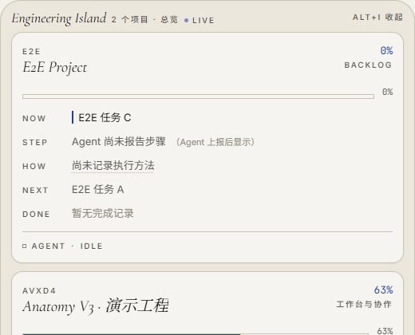
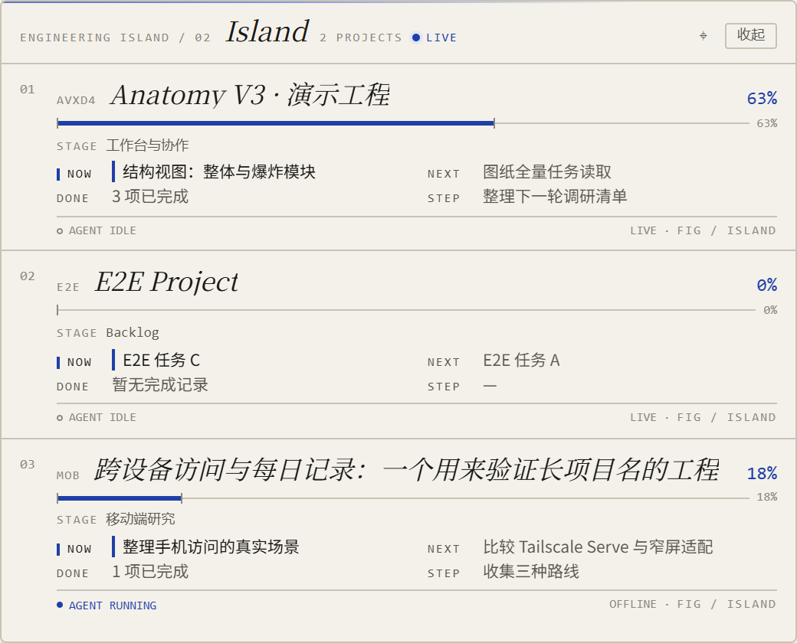
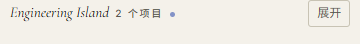
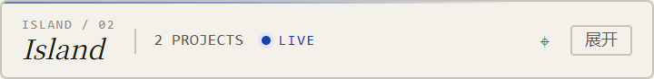

# Phase 2 · Island Blueprint Dock 独立视觉原型

> 日期：2026-10-29 · 状态：**原型完成，未改生产 UI，等待视觉确认**
> 原型：[`prototype.html`](../ui-design/island/v4/prototype.html)
> 规格：[`ISLAND_V3_SPEC.md`](../../ISLAND_V3_SPEC.md) · [`DESIGN.md`](../../../frontend/DESIGN.md) §3.3

## 1. 对照方式

| 当前生产（baseline） | 新原型 |
|---|---|
|  |  |
|  |  |

更多状态：

- [长项目名 / 较多内容](phase2/prototype-long.png)
- [空状态](phase2/prototype-empty.png)
- [加载状态](phase2/prototype-loading.png)

## 2. 具体改进

| 维度 | 当前生产 | 新原型 | 理由 |
|---|---|---|---|
| 表面 | 外层 26px 圆角 + 内部 14px 项目卡 + 阴影 | **4px 外框 + 单一纸面 + 0px 细线分隔** | 遵守 DESIGN §3.3 V3 例外：不堆卡片与阴影 |
| 信息层级 | 每个项目是一张六问卡片，STEP/HOW/DONE 全部同权 | 项目名/进度 → STAGE/NOW/NEXT → DONE/STEP → AGENT/状态 | 现在发生什么优先；细节次级 |
| 视线顺序 | 先看到卡片边界，再读内容 | 从左到右：编号 → 标识/名称 → 进度；向下：STAGE → NOW/NEXT → footer | 细线承担分组，减少装饰竞争 |
| 等宽字体 | 部分使用 | NOW / NEXT / DONE / STEP / 百分比 / 状态统一 JetBrains Mono + tabular-nums | 仪表数据层一致，正文仍为 Inter/衬线标题 |
| 收起态 | 标题 + 项目数 + LIVE + 图钉 + 展开 | 同左，但用小号两行品牌块，避免 360px 挤压 | 先保证可读、可点；不在 44px 内硬塞 NOW |
| 长内容 | 卡片内滚动 | 单列表内滚动，分隔线连续 | 不把每个项目变成独立卡片 |
| 空/加载 | 卡片式空态/骨架 | 同一纸面内的 FIG·EMPTY / 稳定骨架 | 视觉连续，不用 spinner |

## 3. 行为验证（原型层）

- 收起 → 展开、展开 → 收起：原型按钮可切换，`data-state` 正确；
- 图钉按钮：可在原型内切换 `aria-pressed`；
- 无 console/page error；
- **未验证**：原生 pywebview 快速收起/展开、Python 状态机对账、拖动/缩放；本轮只做视觉原型，生产窗口模型未改。Phase 4 再用真机验证这些行为。

## 4. 三项基准

- **轻量化**：从“卡片堆叠”收敛为一张纸面 + 细线分隔；项目行只保留当前最有用的层级，STEP/HOW 不再与 NOW 同权。
- **流畅性**：视觉上减少阴影/嵌套卡片，滚动只发生在项目列表；未引入新动画库，原型切换仅做尺寸/状态演示。
- **日常便捷性**：收起态保持可读可点；展开态一屏能看到项目、阶段、NOW/NEXT 和完成摘要，下一步不用先点开卡片。

## 5. 待确认 / 未做

1. 是否接受 4px 外框、0px 项目分隔、单层阴影的 Blueprint Dock 方向？
2. 收起态是否需要在 360×44 里再加入 NOW（代价是压缩项目数/标题）？
3. STEP/HOW 是否应默认收起，只在 Agent 运行时展开？
4. 本阶段**没有改生产 Island**；用户确认方向后才进入生产实现，并按规格保持单窗两态、现有桥接与状态机。
