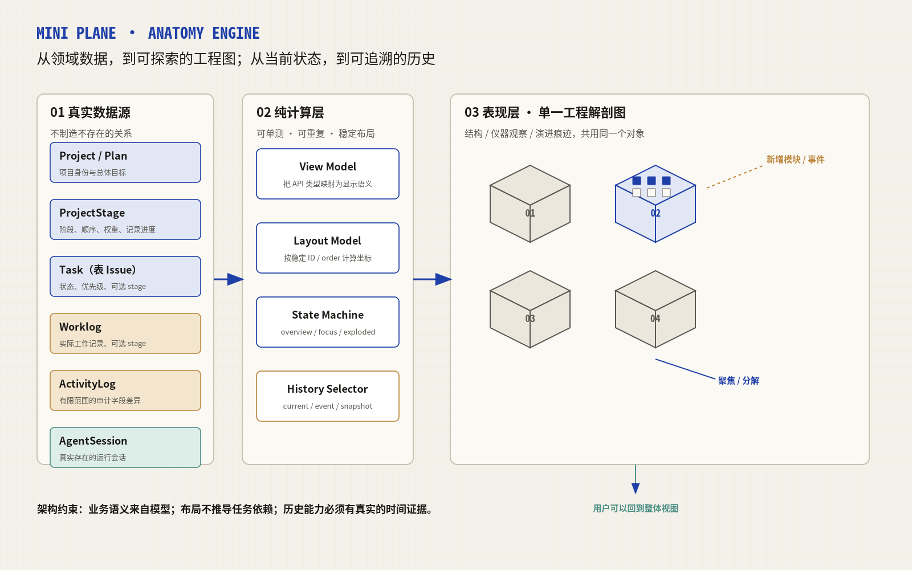
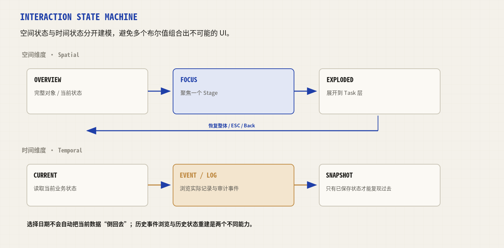
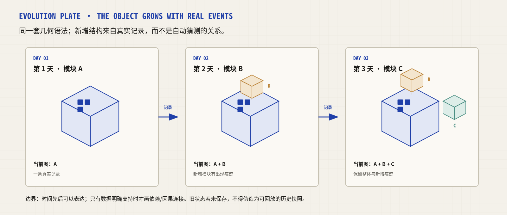
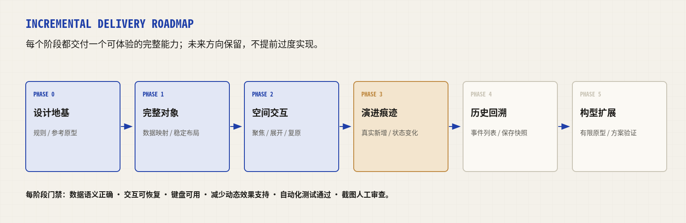

# Mini Plane 工程解剖图：技术调研报告与渐进式实施计划

**版本：** 1.0  
**调研日期：** 2026-10-25  
**目标读者：** 项目负责人、前端实现者、后续 AI Agent  
**项目仓库：** <https://github.com/x7687315-gif/mini-plane>  
**性质：** 设计方向收敛 + 技术选型 + 当前实现审计 + 阶段化实施与验证方案

> **重要声明：** 本报告区分四类内容：①从 Mini Plane 仓库文档/代码可直接核对的事实；②从技术项目官方文档核对的能力与许可；③基于项目目标作出的工程建议；④尚未在目标机器上运行验证的验收假设。报告不把方案建议伪装成已经完成的运行测试。图中原型均为本报告制作的概念示意图，不是应用运行截图。

---

## 摘要：先做对，再逐步做大

### 核心结论

Mini Plane 的项目解剖图应沿着 **Interactive Engineering Plate / 交互式工程解剖图** 的方向演进：不是把多个 3D 小物件摆在一起，而是把同一个项目塑造成一个可阅读、可探索、能留下时间痕迹的对象。

统一的设计语法应有三个维度：

1. **结构维度（Structure）**：回答项目由什么组成；对应 Project、Stage、Task 等真实层级。
2. **精密观察维度（Inspection）**：回答当前某一部分是什么状态；采用标注、刻度、剖切、局部放大、读数等工程制图语言。
3. **演进维度（Evolution）**：回答项目如何发展到今天；通过真实新增模块、状态变化、工作记录、审计记录和未来可选的状态快照表达。

三者不应成为互不相干的三种页面或三套对象。它们应该是**同一个对象的结构、观察和时间表现**。第一版先把整体、聚焦、渐进展开、恢复整体做稳；随后让真实的新变化“长”进对象；最后再为准确回看过去建设历史状态基础。

### 本报告的工程决策

| 决策项 | 建议结论 | 理由 |
|---|---|---|
| 渲染基础 | 继续采用 React + TypeScript + SVG | 项目已有 SVG 原型与 React 技术栈，几何对象、文字标注和细线图纸风适合 SVG；避免无必要的 3D 引擎迁移 |
| 动画 | 先用一个独立 Spike 验证 Motion for React；验证通过后用于 SVG 的聚焦/分解动画 | Motion 官方文档支持 SVG 属性、路径绘制及 `viewBox` 动画；MIT 许可；不必自研完整动画框架 [R1][R2] |
| 布局 | 采用确定性的模块布局，坐标由纯函数计算 | 现有设计要求构件重渲染后不随机换位；力导向布局不适合作为第一版默认布局 |
| 对象设计 | 第一版所有 Stage 共享同一套基本模块语法 | 任务数量不应擅自决定 Stage 的语义形态；构型差异留到真实使用验证后 |
| 历史能力 | 先展示真实事件与新增痕迹，之后再开发可回放快照 | 当前 `ActivityLog` 被明确定义为有限范围的审计留痕，不是完整领域事件流；仅靠它无法可靠重建每个历史时刻 [P3] |
| 技术复用 | 从成熟库借用动画原语与交互模式，不整体引入图形编辑器 | React Flow 的定位是节点/边编辑器；Mini Plane 的解剖图不是任意节点图，也不得凭空画 Task 依赖线 [R3] |
| 开发方式 | 先交付一个完整小体验，再逐层叠加能力 | 每个阶段都有独立完成标准、可验收成果和回归门禁，防止大规模推倒重来 |

### 这份报告提供什么

- 当前仓库状态与代码风险的静态审计。
- 原创的系统架构图、演进示意图、交互状态机和路线图。
- GitHub 相近项目与技术方案对照，包括可复用的能力、不可直接照搬的部分和许可注意事项。
- 数据语义、组件分层、状态机、布局和动画技术建议。
- 分阶段实施任务、可复制技术片段、验证矩阵、用户体验调研问卷。
- 可以直接交给 AI Agent 的分阶段执行提示词。

## 目录

1. [项目目标与设计原则](#项目目标与设计原则)
2. [当前仓库审计](#当前仓库审计)
3. [目标体验：一个对象、三个维度](#目标体验一个对象三个维度)
4. [技术选型与开源项目调研](#技术选型与开源项目调研)
5. [目标架构与数据契约](#目标架构与数据契约)
6. [动画、布局与历史能力设计](#动画布局与历史能力设计)
7. [渐进式实施路线](#渐进式实施路线)
8. [验证计划与验收矩阵](#验证计划与验收矩阵)
9. [设计研究问卷与用户验证方案](#设计研究问卷与用户验证方案)
10. [风险、限制与停止条件](#风险限制与停止条件)
11. [交给 AI Agent 的执行模板](#交给-ai-agent-的执行模板)
12. [调研证据与参考链接](#调研证据与参考链接)

---

# 1. 项目目标与设计原则

## 1.1 从刚刚形成的设计共识出发

这不是普通任务列表的 3D 化，也不是在页面上加入一张装饰插画。项目解剖图应该成为一种新的项目阅读方式：

- **整体可理解**：默认视图一眼可见项目的总体组成，所有可见部件属于同一个整体。
- **局部可探索**：点击某个阶段后，可以聚焦、放大、剖切或逐级展开；用户始终知道它原本处于整体中的什么位置。
- **历史可追溯**：当真实记录显示项目发生变化时，工程图能够留下变化痕迹；只有数据确实保存了历史状态时，才提供准确的过去状态复现。
- **视觉与语义一致**：形状、颜色、尺寸和连接线都必须有可说明的意义；不能为了画面丰富凭空创造依赖、因果或进度。
- **渐进式成长**：第一版无需知道未来所有形态；只需要留下稳定的对象身份、确定性布局、清楚的数据映射和可扩展的交互状态。

可以用一句话概括：

> **项目的结构可以被看见，内部可以被打开，变化可以留下痕迹；但视觉表达永远不能超出真实数据所支持的含义。**

## 1.2 六个宏观目标域

| 目标域 | 要回答的问题 | 第一版边界 | 后续扩展 |
|---|---|---|---|
| A. 工程视觉语言 | 它看起来像什么？ | 纸面、细线、钴蓝、精确标注、同一基本对象 | 限定的构型变体、材质/剖面语言 |
| B. 项目结构 | 它由什么组成？ | Project → Stage → Task 的真实层级；未归属 Task 保留可见 | 更丰富的 Stage/Task 细节和布局 |
| C. 空间交互 | 我如何探索？ | 全景、聚焦、展开、复原 | 多级剖面、局部放大、快捷键与视图记忆 |
| D. 时间演进 | 它怎样变成现在这样？ | 当前记录驱动的新变化痕迹 | 时间轴、状态快照、过去与现在比较 |
| E. 构型适应 | 不同项目是否可以有差异？ | 不按类别硬分型，先统一对象语法 | 有限的项目表达构型，按验证结果决定 |
| F. 可持续工程 | 怎样不断增加而不推倒重来？ | 纯数据映射、纯布局函数、清晰状态机、测试样例 | 历史存储版本、复杂交互、性能分层 |

这六个目标并非必须线性完成。尤其是历史可追溯性：完整历史界面可以晚做，但哪些数据是真实事件、哪些数据是当前状态，以及未来快照需要保存什么，应该尽早明确。

## 1.3 视觉隐喻的职责划分

| 维度 | 应使用的设计元素 | 不应做的事 |
|---|---|---|
| 结构型 | 模块、层级、剖面边界、稳定空间位置 | 把每个 Stage 画成互不相关的小玩具；不明示真实层级 |
| 仪器型 | 刻度、读数、图签、细微标记、局部放大、剖切线 | 把所有信息塞成密集仪表盘；为了科技感堆满装饰线 |
| 演进型 | 新模块的出现、旧/新轮廓、时间标记、真实变化批注 | 把日期先后画成依赖关系；用动画冒充保存过的历史快照 |

### 原创图 1：三种设计维度共用一个渲染系统



图中为概念架构示意。模块名称为本报告建议，不代表当前项目已具有所有模块。

---

# 2. 当前仓库审计

## 2.1 审计范围与证据级别

本次检查了 GitHub 仓库中以下文件（通过仓库文件内容读取，日期为 2026-10-25）：

- `frontend/components/anatomy/AnatomyPlate.tsx`：当前解剖图组件源码。[P1]
- `docs/refactor/ui-design/anatomy/ANATOMY_IMPLEMENT_REPORT.md`：已有实现报告与历史验证记录。[P2]
- `docs/DOMAIN_MODEL.md`：目标领域模型与数据语义。[P3]
- `docs/api/06-activities.md`：Activity/Audit Trail 接口契约。[P4]
- `frontend/DESIGN.md`：Blueprint Editorial 设计系统。[P5]
- `frontend/package.json`：前端依赖和测试脚本。[P6]
- `README.md`：项目技术栈、产品定位和历史测试摘要。[P7]

**验证边界：** 本次是基于当前仓库文件的静态审查和官方技术文档调研；没有在本次报告生成过程中克隆仓库、安装依赖、运行 `pnpm test` 或启动浏览器复测。因此下面的“发现”分为源码直接可见项、文档记载项和待运行验证项。已有报告中写着“实测通过”不等于本报告再次独立复跑了该测试。

## 2.2 当前技术栈：应沿用已有基础

`frontend/package.json` 列出了以下相关依赖：[P6]

| 领域 | 当前依赖/技术 | 对本任务的意义 |
|---|---|---|
| UI | React `19.2.8`、Next.js `16.3.5` | 原有组件继续复用，不需要迁移 UI 框架 |
| 类型 | TypeScript `^5` | 适合建立领域视图模型与判别联合状态机 |
| 样式 | Tailwind CSS `^4` | 继续使用已有 token 与页面布局规则 |
| 状态 | Zustand `^5` | 项目已经有状态管理库，但单个解剖图视图状态不一定需要进入全局 store |
| 测试 | Node 内置 test runner 脚本、Playwright、Lighthouse | 可以以现有测试基础建立绘图、交互和浏览器回归门禁 |
| 包管理 | pnpm `11.25.0` | 新依赖应使用 pnpm，并锁定 lockfile |

**依赖决策：** 不要为追求“工程感”先引入 Three.js、React Flow、D3 Force 或大型画布编辑器。第一阶段继续用原生 SVG，并仅在动画 Spike 有明确价值时再添加 Motion for React。

## 2.3 已有解剖图实现了什么

`AnatomyPlate.tsx` 已有：

- 30° 等距投影的数学映射函数和 SVG 多边形构件生成函数。
- Stage → Task 的分组；未归属阶段的任务进入单独的“散件”区域。
- 根据 Task 状态对构件进行视觉区分，并标记真实的 NOW Task。
- 一个 Stage Index 面板和聚焦状态下的任务清单；任务可打开现有任务抽屉。
- 确定性散布函数，以及“投影辅助线不是依赖关系”的语义标注。
- 空状态和图纸图签。[P1]

仓库的实施报告记载，原实现采用“爆炸轴测主体 + 剖切聚焦 + 编辑式信息面板”的复合 PLATE 方案，并记载曾以真实数据测试阶段索引聚焦、任务抽屉和缓存问题的回归修复。[P2] 这些成果应作为可复用基础，而不是直接抛弃。

## 2.4 当前实现与新方向之间的主要差距

以下是对源码的静态观察，不等于视觉截图评审；这些项目应在第一轮重构中通过代码改进和运行测试验证。

### 发现 A：构型由 Task 数量阈值决定

当前 `archetype(taskCount)` 选择：0 个任务为 `foundation`，1-3 为 `openbox`，4-6 为 `portal`，7 个以上为 `campus`。[P1]

这让同一个 Stage 可能随着任务数量跨过阈值，突然换成另一种建筑形态。视觉上变化是明显的，但语义不够稳定：**任务数量本身不一定意味着阶段的性质已经改变**。新方向建议：先让 Stage 共用一个基本模块语法；任务数量主要改变内部构件数量/排布密度，而不是改变整个 Stage 的类别。构型差异作为后续设计实验，不作为第一版的隐含业务规则。

### 发现 B：绘图布局依赖固定画布常量

源码使用 `VB = { w: 1160, h: 620 }`，并按 `i % 4` 和 `Math.floor(i / 4)` 放置 Stage；聚焦时将选中 Stage 放大到固定坐标，其余 Stage 被压成基线条。[P1]

固定 viewBox 本身不是问题；问题是目前的布局规则没有公开的“内容包围盒/碰撞检测/超出边界处理”契约，而且 HTML 索引面板覆盖在 SVG 上层。散件托盘、图例和侧面板在阶段数或容器尺寸变化时可能产生重叠。应增加 0、1、3、4、8、12、20 个 Stage 的布局测试，不以“在一个常见数据集上看着没问题”作为完成标准。

### 发现 C：SVG 先拼接为字符串，再通过 `dangerouslySetInnerHTML` 注入

源码将 Stage 名称、阶段目标、项目 identifier 等动态文本拼入 SVG 字符串，然后用 `dangerouslySetInnerHTML` 渲染。[P1] React 官方明确提醒：如果原始 HTML/SVG 字符串包含未经信任的数据，可能引入 XSS 风险。[R4]

这不意味着当前代码一定已经存在可利用漏洞——需要结合输入校验和数据来源进一步验证；但在用户可编辑的 `stage.name`、`stage.goal` 等字段上，**不能把“目前是本地应用”当成免审理由**。建议把图形改为 React JSX 管理的 SVG 节点，例如 `<polygon>`、`<text>{stage.name}</text>`。这样用户文本由 React 正常转义，不再把业务文本拼进 markup 字符串。若确有必须注入 SVG 字符串的特殊需求，必须实现并测试 SVG/XML 语境下的正确转义与安全策略；优先方案仍是 JSX。

### 发现 D：图形组带有点击提示属性，但实际交互主要靠 HTML 索引表

源码生成的 `<g>` 有 `cursor:pointer` 和 `data-i`，但组件内 SVG 根节点没有给这些 SVG Group 绑定相应的点击/键盘处理器；可靠的 Stage 聚焦入口是右侧 HTML 索引表。[P1] 这解释了“图形看起来能点击”与“图形是否真能直接点击”不是同一回事。

建议：让视觉构件真的成为交互对象，或明确它只是静态图示；交互组应具有可见焦点、键盘入口和 `aria-label`，并保留 HTML 索引清单作为等价、稳定的无障碍操作入口。SVG 的 `<title>` / `<desc>` 可补充可访问名称和描述，但不能代替真实的键盘交互。[R8][R9]

### 发现 E：当前历史数据并不构成可完整回放的时间模型

`docs/DOMAIN_MODEL.md` 将 Worklog 定义为实际工作记录，可关联 Project/Stage；ActivityLog 则是系统审计记录。[P3] `docs/api/06-activities.md` 更明确地说明：Activity 记录“谁在什么时候把什么改成了什么”，不是 Domain Event；MVP 的字段范围有限，例如描述变更仅记录字数摘要、评论正文不进入审计载荷，部分 Label/State/Workspace/Member 变化也不在当前接线范围内。[P4]

因此：

- 当前 ActivityLog 可以支撑它实际记下来的审计事件，不可假定覆盖全部项目状态变化。
- Worklog 可表达“做了什么/结论”，但它不必然记录每次 Task/Stage 数据变化。
- `created_at`、用户填写的工作日期和“变化真正发生的时间”可能是不同概念，补录历史时尤其如此。
- **要精确重建某日的整个项目结构，需要额外保存当时的状态快照或足够完整、可重放的领域事件。** 目前不应声称已具备该能力。

### 发现 F：需要区分“阶段进度”“Task 状态统计”和“项目总进度”

领域模型对项目总进度定义了来源：存在 Plan、Stage 且权重和大于 0 时使用 Stage 加权进度；否则回退为 Task 完成率，并返回 `progress_source`。[P3] 因此视觉层不能把 Task 立方体完成比例直接当成 Stage 记录进度，也不能再在前端自行计算另一份项目总进度。

### 发现 G：仓库文档中的历史测试计数不一致

README 中的概述和解剖图实施报告中的测试数是不同时间点/范围的记载：README 列出了前端 143 单测及 34 个 E2E，同时列出的后端数与实施报告中的后端测试数不一致。[P2][P7] 这不一定是代码质量问题，但意味着**测试数量不能当作当前分支的实时 CI 结果**。第一轮改动前需要在目标分支重跑标准门禁并记下 commit SHA 与输出。

## 2.5 当前审计的优先级

| 优先级 | 项目 | 为什么先处理 |
|---|---|---|
| P0 | 基准门禁：当前分支 typecheck/lint/unit/build/E2E 的真实结果 | 防止把旧记录误认为当前状态 |
| P0 | 移除或严格审计 `dangerouslySetInnerHTML` 的动态 SVG 拼接 | 新功能会继续增加用户可编辑文本和动画状态，不应把风险放大 |
| P1 | 确定性布局的边界/溢出/遮挡测试 | 直接影响整体可读性与后续动画的稳定性 |
| P1 | 构型与数据语义解绑 | 防止任务数量变化导致对象形态无明确理由地突变 |
| P1 | 可点击图形的指针、键盘和读屏语义 | 不能只做视觉可点的“假按钮” |
| P2 | 历史事件、录入时间、状态快照的概念边界 | 可先不做完整时间轴，但必须避免混用数据语义 |

---

# 3. 目标体验：一个对象、三个维度

## 3.1 四种空间状态

1. **Overview / 完整呈现**：对象完整；Stage 位置稳定；重要状态有直接标记；主图不是小模型集合。
2. **Focus / 聚焦**：选中一个 Stage，其他部分降权但保留足够上下文；索引面板仍能切换其他 Stage。
3. **Exploded / 渐进展开**：只在选中区域内展开到下一层，例如 Task 构件从模块中分离出来；构件能回到原位。
4. **Restore / 恢复整体**：用户可通过“整体”按钮、Esc 或再次选择当前 Stage 回到 overview；焦点不丢失，URL/路由语义仍然有效。

动画不是“零件飞散”。分解前用户必须看懂整体；分解时保留原来位置的幽灵轮廓/锚点；收起时动作可逆。否则它只是一种装饰效果，不是理解结构的工具。

## 3.2 时间维度与空间维度应该组合，而不是互相替代

同一张图纸可搭配两种独立的选择状态：

- **Spatial state**：全景、聚焦、展开。
- **Temporal state**：当前状态、查看某个真实事件/记录、查看某个已保存快照。

这样既可以在当前状态里聚焦 Stage，也可以在某个已保存历史状态中聚焦同一个 Stage。不要让一个含糊的 `isHistory` 布尔值同时控制动画、数据源与详情面板。

### 原创图 2：交互状态机



## 3.3 第 1 天 A、第 2 天 B、第 3 天 C：对象逐步成长

例如：第一天存在模块 A；第二天有真实记录说明新增了 B；第三天又新增 C。我们希望对象能够展示 A → A+B → A+B+C 的变化，而不是只在右侧日志里增加三行文字。

实际实现时，每次变化应使用真实的稳定 ID 来对齐对象；只有新 ID 真实出现时，才播放“新增结构”的进入动画。首次加载完整项目时，不应把所有既有模块都假装成刚刚新增的模块。

### 原创图 3：演进型工程解剖图的概念示意



**必须遵守的历史真实性规则：** 时间先后可以用时间线表达，但时间先后不等于依赖；空间靠近不等于关联；没有保存旧状态，就不能提供准确的旧状态回放。

## 3.4 第一版的对象构型建议

第一版优先采用**统一的抽象模块化工程对象**：Stage 拥有一致的基本轮廓，内部 Task 按真实归属排列；精密仪器感由标注、刻度、剖面、读数和局部观察提供；演进感通过真实新增模块和历史痕迹提供。

不建议第一版就采用：

- 所有项目都必须是齿轮：物体隐喻太具体，难以适配工作、学习、生活类项目。
- 每个项目都自由选择不同物体：设计和维护成本急速增加，也会破坏视觉语言的一致性。
- 工作/学习/生活硬性映射固定物体：类别与结构不一定有稳定对应关系。

将来可以试验有限的构型，但要通过真实使用场景验证，而不是由类别字段直接决定图形。**先统一交互与语义语法，之后再扩展外观原型。**

## 3.5 第一版信息编码规则

| 数据 | 建议的第一版视觉映射 | 需要避免的误导 |
|---|---|---|
| Stage 顺序/身份 | 稳定位置、编号、名称 | 不随 React 重渲染随机换位 |
| Stage 的 `progress` | 明确标注数值，配一个不抢眼的独立进度编码 | 不与 Task done 比例混算 |
| Task 状态 | 同时用颜色与形状/线型区别状态 | 不只靠颜色；色彩不得变成纯装饰 |
| Task 所属 Stage | 置于所属模块的内部空间 | `stage=null` 的任务应在独立中性区域展示，不隐藏、不羞辱 |
| `weight` | 先保留数值/图签；若用几何尺寸表达，必须解释含义并做可读性测试 | 不要让高度被误读为进度或任务数量 |
| NOW | 只标真实 started Task，且符合领域服务的稳定定义 | 不根据用户最近点击或随机选择伪造 NOW |
| NEXT | 使用真实 `plan.next_stage` 或领域定义 | 不把视觉上最靠前的对象当成 NEXT |
| Worklog | 作为时间批注/记录标记，可跳转阅读真实记录 | 不把一条 Worklog 当成任务依赖线 |
| Agent | 只有真实 AgentSession/运行态存在时显示 | 不因“项目正在开发”就写 AGENT RUNNING |
| 依赖关系 | 当前不绘制 Task↔Task 依赖线 | 不推导不存在的模型边 |

---

# 4. 技术选型与开源项目调研

## 4.1 选型原则

本项目优先级不是“选最炫的库”，而是：

1. 与现有 React/TypeScript 栈兼容，能局部引入。
2. 库本身成熟、公开文档清楚、许可容易理解。
3. 不让技术模型反过来规定产品语义。
4. 允许项目保留自己的 SVG 对象和 Blueprint Editorial 视觉系统。
5. 可以逐步迁移：第一版不强迫使用所有能力。
6. 可测试、可访问、尊重减少动态效果偏好。

## 4.2 方案对照表

> 以下的“适配度”是针对 Mini Plane 当前目标的工程判断，不是由用户实验得出的统计分数。许可结论应以锁定版本中的 LICENSE 文件为准；升级依赖时复查。

| 项目/技术 | 官方能力 / 许可 | 与本项目的适配方式 | 当前决策 |
|---|---|---|---|
| **原生 React SVG** | 浏览器原生矢量元素；无需第三方图形框架 | 几何模块、标注、剖面、图纸线条；React 管理属性和文本 | **基础必选** |
| **Motion for React** | React 动画库；支持 SVG 元素与 `viewBox` 动画；MIT [R1][R2][R10] | 聚焦、局部展开、模块进入/退出；稳定 ID + transform/opacity | **先做短 Spike；通过后用于核心动画** |
| **React Flow (`@xyflow/react`)** | 节点/边编辑器，具备拖拽、缩放、平移、选择、键盘交互；MIT [R3] | 可参考 viewport、选择和可访问交互思路 | **不作为主渲染器**，因为项目不是通用 node-edge 图编辑器 |
| **D3 Force (`d3-force`)** | 基于物理模拟的力导向布局 [R5] | 对真实网络关系/碰撞避让等图形任务有用 | **第一版不采用默认力导向布局**，稳定位置与真实关系更重要 |
| **ELK.js** | 图布局计算库，尤其是有方向的分层节点-连线布局；EPL-2.0 [R6][R7] | 若将来确实出现真实有向关系图，可评估布局算法 | **暂不引入**：当前领域没有 Task 依赖边；额外许可审查与复杂度不必要 |
| **React Chrono** | React 时间线组件，MIT；含多种时间线布局、键盘导航和 i18n [R11] | 可以快速验证“历史事件列表/时间线”交互 | **仅作为后续原型参考**；最终时间层可能需要跟图纸同一视觉语言 |
| **vis-timeline** | 可交互、可缩放时间轴与范围项目 [R12] | 适合密集区间/排期类时间数据 | **当前不作为首选**；我们的第一种历史是“变化痕迹”，不是甘特或区间排期 |
| **CodeCharta** | 把代码库映射成可探索城市，并能比较两个版本地图 [R13][R14] | 很好的“结构 + 指标 + 版本差异”概念参照 | **研究其信息编码，不照搬 3D 城市/整套引擎**；领域与项目任务不同 |
| **Excalidraw** | MIT 开源手绘白板/绘图编辑器 [R15] | 可参考交互式图形和编辑器的成熟实践 | **不直接嵌入**：无限画布/自由绘制与确定性工程图有不同目标，手绘风也不是现有视觉语言 |

### 结论

**推荐组合：React JSX SVG + 确定性纯函数布局 + Motion for React（通过 Spike 后）+ 现有 HTML 信息面板。**

它以最低迁移成本保留现有对象和图纸语言；Motion 只解决插值、进入/退出和 `viewBox` 过渡，不负责业务建模与布局；历史时间轴在后续需要时再选择自绘或引入专用库。

## 4.3 为什么 Motion 值得优先验证

Motion 官方 SVG 文档明确覆盖：

- SVG 元素属性和样式动画。
- `pathLength` 等路径绘制效果。
- 相似 SVG 路径之间的形状 morph。
- `viewBox` 动画，可用于平移/缩放视图。[R1]

官方 React 文档也支持共享布局/进入退出动画，且仓库许可文件为 MIT。[R2][R10] 这些恰好能覆盖我们第一批所需的动画原语：Stage 聚焦、模块位置迁移、Task 逐个展开、重新收拢。

**边界：** Motion 不负责决定“哪个 Stage 应该在什么位置”，也不能帮我们自动恢复没有保存的历史数据。动画库不能代替布局算法、领域模型或历史存储。

建议先做一个隔离的 1-2 个组件 Spike，分别验证：

1. 一个 SVG `<g>` 的平移、透明度与退出/进入。
2. 一个 `viewBox` 从全景到聚焦再回全景。
3. 连续快速点击不同 Stage 时动画可中断且最终停在正确状态。
4. 系统启用减少动态效果时，动画被关闭或替换成瞬时状态切换。

如果这些场景运行稳定，再加入主组件。不要在 Spike 阶段先重写完整 AnatomyPlate。

## 4.4 为什么不直接采用 React Flow

React Flow 的确是成熟的 React 图形交互库，并且自带平移、缩放、选择和键盘交互等能力。[R3] 但它的基本抽象是 **nodes + edges**。Mini Plane 当前的对象不是任意关系图：Stage 是有序层级，Task 可选属于某个 Stage，模型没有 Task↔Task 依赖关系。

直接把项目建模为节点和连线，很容易为了库的抽象去添加“看起来合理但模型中不存在”的边，或花时间隐藏节点编辑器默认体验。我们的主图需要的是统一的工程对象，而不是用户自由拖动的通用关系图。

可以参考它如何处理选择状态、键盘、视窗与可访问性，但没有足够理由将其作为渲染主引擎。

## 4.5 为什么不使用力导向布局作为第一版

D3 Force 擅长用物理模拟布置网络、层级与避免节点碰撞。[R5] 这种方式适合“关系网络需要自动找位置”的场景；但 Mini Plane 的 Stage 顺序和空间结构应稳定、可解释并能复原。

对我们的第一版来说，确定性布局有几项优势：

- 同样的数据与容器尺寸，重复计算得到同样坐标。
- 聚焦/展开动画的起点和终点明确。
- 用户能逐渐建立空间记忆，不会每次刷新都需要重新找模块。
- 不会暗示真实领域模型中不存在的网络结构。

若将来需要复杂避让算法，也应先把算法封装在纯 `computeLayout()` 边界中，确保输入/输出可测试且确定；不要把物理模拟的持续运行状态直接当成业务状态。

## 4.6 相近项目的启发

### CodeCharta：将数据结构变成可阅读的空间

CodeCharta 用可探索的代码城市表达文件/目录结构、指标、领域词汇和依赖，并支持比较两个版本的地图。[R13][R14] 它给 Mini Plane 的启发不是“也做一座城市”，而是：一个对象可以复用同一份数据，切换不同观察维度；版本差异也可以通过地图表达。

不可直接照搬的部分：CodeCharta 面向代码指标，采用 3D 城市/treemap 语法；Mini Plane 面向个人项目阶段、任务与工作记录，需要轻量、桌面友好、与 Blueprint Editorial 统一的 2D/2.5D 工程图。

### React Flow：复杂图形交互的成熟经验

借鉴选择、视窗、键盘与可访问交互的方案；不要把其自由节点编辑模型带入核心领域语义。[R3]

### React Chrono / vis-timeline：时间表达的已有轮子

当历史事件多起来时，可用 React Chrono 或 vis-timeline 快速做交互验证；但先以一份真实数据构建自定义的时间事件视图，确认用户确实需要缩放、分组或区间后，再决定是否引入组件库。[R11][R12]

### Excalidraw：成熟的图形编辑体验

它证明了 React 下开源绘图编辑器的成熟路线，但其手绘语言、无限画布与任意绘制能力和 Mini Plane 的“确定性工程对象”不同。适合学习复杂交互设计，不代表应整库嵌入。[R15]

---

# 5. 目标架构与数据契约

## 5.1 推荐的组件分层

建议将现有组件逐步分出清晰职责；不要求一次性按理想结构拆完，但新代码应向这个边界靠拢：

```text
AnatomyPlate (React shell)
├─ AnatomyToolbar / ViewControls
├─ AnatomyScene (semantic SVG)
│  ├─ ProjectBase
│  ├─ StageModule (stable id)
│  │  ├─ StageShell / SectionCut
│  │  ├─ TaskComponent (stable id)
│  │  └─ StageAnnotations
│  ├─ LooseTaskTray
│  └─ HistoryMarks (later)
├─ StageIndex (HTML list/table, keyboard accessible)
├─ StageDetail / Task drawer integration
└─ HistoryPanel (later)

Pure functions / hooks:
- selectAnatomyViewModel(api data)  → display model
- computeAnatomyLayout(viewModel, viewport, spatialState) → coordinates
- transitionSpatialState(current, action) → next state
- selectHistoryView(current data, worklogs, audit, snapshot) → temporal model
```

不要让同一个文件同时负责：领域映射、坐标计算、拼 SVG 字符串、动画状态、时间重建和 DOM 安全策略。每个模块应该能独立测试。

## 5.2 领域视图模型

现有领域模型已经提供以下数据语义：[P3]

- `Project`：项目身份。
- `ProjectPlan`：目标/计划。
- `ProjectStage`：阶段顺序、名称、权重、当前阶段标记和记录进度。
- `Task`（当前底层表名 Issue）：属于 Project，可选归属 Stage。
- `Worklog`：真实工作记录，可选关联 Stage。
- `ActivityLog`：有限范围审计留痕。
- `AgentSession`：真实存在的 Agent 会话，可选关联 Task。

建议建立独立的只读视图模型，而不是在 SVG 生成时反复从原始 API 类型临时推断：

```ts
export type AnatomyTask = {
  id: string;
  sequenceId: number;
  title: string;
  state: 'backlog' | 'unstarted' | 'started' | 'done' | string;
  priority: string;
  stageId: string | null;
};

export type AnatomyStage = {
  id: string;
  order: number;
  name: string;
  goal: string | null;
  recordedProgress: number; // Stage 记录进度，不等于 Task 完成率
  weight: number;
  isCurrent: boolean;
  tasks: AnatomyTask[];
};

export type AnatomyViewModel = {
  projectId: string;
  identifier: string;
  stages: AnatomyStage[];
  looseTasks: AnatomyTask[];
  nowTaskId: string | null;       // 应使用领域契约派生出的 NOW
  nextStageId: string | null;     // 使用真实 plan.next_stage
  agentSession: null | { id: string; status: string; taskId: string | null };
  projectProgress: number;
  progressSource: 'plan' | 'tasks';
};
```

以上是建议接口示例，字段应对照实际 API 类型落地；`state` 的实际枚举也应以现有契约为准。不要为了示例代码把新的字符串枚举直接复制到生产实现中。

## 5.3 状态机：空间状态与时间状态分离

空间状态建议使用判别联合类型，避免 `isFocused`、`isExpanded`、`isHistory` 等布尔值同时存在导致状态不合法：

```ts
export type SpatialState =
  | { mode: 'overview' }
  | { mode: 'focus'; stageId: string }
  | { mode: 'exploded'; stageId: string; level: 'tasks' };

export type TemporalState =
  | { mode: 'current' }
  | { mode: 'event'; eventId: string }
  | { mode: 'snapshot'; snapshotId: string };

export type AnatomyUIState = {
  spatial: SpatialState;
  temporal: TemporalState;
};
```

空间与时间可以组合：例如 `spatial.mode='focus'` 与 `temporal.mode='snapshot'` 同时成立。但在 `spatial.mode='exploded'` 中必须有可验证的 `stageId`。每次切换项目时，应清理已经失效的 stage/task/snapshot 选择。

建议明确定义动作与转换：

| 触发动作 | 状态结果 | 约束 |
|---|---|---|
| 打开解剖图 | overview + current | 当前数据完整可见 |
| 点击 Stage | focus(stageId) | `stageId` 必须存在于当前项目 |
| 在聚焦状态再次展开 | exploded(stageId, tasks) | 不生成新业务关系，只展开其 Task 子项 |
| 点击“整体”或 Escape | overview | 动画结束后状态与视觉必须一致 |
| 选择另一个 Stage | focus(newId) | 可中断前一个动画；最终状态归新选择 |
| 选择历史事件 | temporal=event(eventId) | 仅展示该事件支持的记录，不假装重建完整旧状态 |
| 选择历史快照 | temporal=snapshot(snapshotId) | 只能选择真实保存且属于当前项目的快照 |

## 5.4 布局模型：先确定，再动画

`computeAnatomyLayout()` 应为纯函数：输入已映射的 Stage/Task、容器尺寸与空间状态；输出每个稳定 ID 对应的坐标、包围盒、层级和视觉权重。布局函数不读 DOM、不改数据库、不产生副作用。

建议约束：

1. 输入对象的顺序以 `Stage.order` 和稳定 ID 明确排序，不依赖 JavaScript 对象偶然的顺序。
2. 相同输入与相同容器尺寸必须得到相同输出。
3. 默认视图不把 Stage 面积/高度暗示成未定义的指标。
4. Task 归属以 `Task.stage` 为准；`stage=null` 放入中性散件区域。
5. 布局不推导 Task 间的依赖、因果或顺序关系。
6. 聚焦视图只改变展示坐标/可见性，不改领域数据。
7. 所有 SVG 图形都应在计算出的内容包围盒内，面板与主图使用独立布局，不互相覆盖。
8. 采用确定性模块布局；复杂自动布局算法只能作为独立实现替换，不能偷偷改动业务语义。

可先采用规则布局/模块网格，再按实测结果增加间距、缩放和聚焦策略。首轮无需自动图布局引擎。

## 5.5 SVG 渲染安全与可访问性

推荐从字符串拼接改为 React 管理的 SVG：

```tsx
<svg viewBox={viewBox} role="img" aria-labelledby="plate-title plate-desc">
  <title id="plate-title">{projectName} 项目解剖图</title>
  <desc id="plate-desc">显示项目阶段、任务状态和当前选中范围。</desc>
  {stages.map((stage) => (
    <g
      key={stage.id}
      role="button"
      tabIndex={0}
      aria-label={`阶段 ${stage.order}：${stage.name}`}
      aria-pressed={spatial.mode !== 'overview' && spatial.stageId === stage.id}
      onClick={() => dispatch({ type: 'FOCUS_STAGE', stageId: stage.id })}
      onKeyDown={(event) => {
        if (event.key === 'Enter' || event.key === ' ') {
          event.preventDefault();
          dispatch({ type: 'FOCUS_STAGE', stageId: stage.id });
        }
      }}
    >
      <polygon points={stage.topFacePoints} />
      <text x={stage.labelX} y={stage.labelY}>{stage.name}</text>
    </g>
  ))}
</svg>
```

这是结构示意，不是可以直接复制的完整代码：还需要为 SVG group 添加明确的焦点样式、足够的点击区域、合适的颜色/线型和已验证的坐标。复杂交互图形也应保留 HTML 的 Stage Index 作为可键盘导航的替代入口。`<title>` 与 `<desc>` 能提供名称/描述，但不能取代实际的交互支持。[R8][R9]

**安全门禁：** 不允许将用户编辑的 `Stage.name`、`Stage.goal`、Task title 等直接插入原始 SVG/HTML 字符串。优先使用 JSX；若使用字符串必须单独审计并写测试，不能只凭数据“通常是文本”来认定安全。

---

# 6. 动画、布局与历史能力设计

## 6.1 动画原则

考虑现有 `frontend/DESIGN.md` 对动画的约束：常规动效 150-250ms、克制的 ease-out、优先 transform/opacity，避免弹跳与大位移。[P5] 工程图的“渐进展开”比普通按钮反馈复杂，可以在验证阶段把整个状态转换控制在约 250-380ms；如涉及多级错峰出现，应把总时长限制在 400ms 左右，并在验证后再更新设计约定，而不是私下加长全部动效。

建议：

- 聚焦：视图框/模块位移 + 背景/其他模块透明度变化。
- 展开：子构件从稳定锚点分离，按层级轻微错峰出现；路径线逐步绘制可作为次要效果。
- 收拢：每个子构件回到原始锚点，不使用随机散开的轨迹。
- 新增模块：只对真实新增的模块播放入场；初始加载不把已有模块逐一“演出”成新内容。
- 状态变化：颜色、边线或小型标记的轻微过渡，保留颜色外的形状提示。
- 减少动态效果：使用 `prefers-reduced-motion` 或应用内设置取消非必要运动，改为瞬时切换/淡入淡出。W3C 将可被关闭的交互触发动画列为一项可访问性成功准则的做法之一；MDN 说明该媒体特性广泛可用。[R8][R16]

## 6.2 Motion SVG 片段示例

下面示例展示“由布局坐标决定终点、由 Motion 负责插值”的职责分离：

```tsx
import { motion, useReducedMotion } from 'motion/react';

function StageShape({ layout, focused }: {
  layout: { x: number; y: number; opacity: number };
  focused: boolean;
}) {
  const reduceMotion = useReducedMotion();
  return (
    <motion.g
      animate={{
        x: layout.x,
        y: layout.y,
        opacity: reduceMotion ? 1 : layout.opacity,
      }}
      transition={{
        duration: reduceMotion ? 0 : 0.28,
        ease: [0.2, 0.8, 0.2, 1],
      }}
    >
      {/* 用 JSX 描述 faces / labels，而不是注入原始 SVG 字符串 */}
    </motion.g>
  );
}
```

使用前需要验证当前 Motion 版本、Next.js Client Component 边界和实际 SVG 动画行为。`layout`、`x`、`y` 的具体用法须按选定库版本的 API 文档做小规模验证；上例说明的重点是职责分离，而不是完整组件。

如果目标只需 2-3 个 CSS 属性，先用 CSS 过渡就足够。若必须协调 SVG `viewBox`、可中断的布局动画和进入/退出，Motion 才体现出明显的复用价值。[R1][R2][R10]

## 6.3 性能策略

第一版应该先优化数据与 DOM 结构，不要提前做高复杂度的渲染优化：

- SVG 元素使用稳定 `key`，以 Stage/Task ID 为依据。
- 坐标计算放在纯函数；通过输入依赖缓存结果，不把整个 SVG 串拼接成一大段原始 markup。
- 默认视图不同时对每一个装饰面进行持续动画；只对真正变化的组进行动画。
- 避免每帧 setState；动画库负责插值，React 状态负责目标状态。
- Task 很多时，先减少装饰子元素并测量实际性能，再决定是否需要分层/虚拟化。
- 不允许为了性能直接隐藏真实 Task；若概览只显示抽象密度，必须提供可探索的清单与精确计数。

建议设定可测量的目标而不是虚构现有性能：在参考测试机上记录 1、3、8、16 个 Stage 与 30、100、300 Task 的渲染时间、交互起始延迟与动画中帧表现。先收集基线，再决定是否引入更复杂的性能策略。

## 6.4 演进时间层：不要把日志、事件与快照混为一谈

推荐分三层实施：

### E1. 当前与最近变化（先做）

当服务端返回当前业务数据与真实 Activity/Worklog 时，识别当前视图相较上一次已知视图发生的变化。对真实新增的 Stage/Task 显示一处标记或入场动画；记录来源和时间。若应用冷启动后没有可靠“上一次结构”，就直接呈现当前对象，不要伪装成刚发生变化。

### E2. 事件/记录浏览（中期）

提供按日期浏览 Worklog 与 ActivityLog 的能力。来源类型要明确：

- **Worklog**：用户记录的工作内容/结论，业务日期可能允许补记。
- **ActivityLog**：系统记录的有限字段审计差异，按 `created_at` 排序，不保证同一时间戳内的先后顺序。[P4]
- **AgentSession**：只表示真实会话，不能拿 Agent 的当前状态填充过去时刻。

为了科学地排序，未来若需要精确时间语义，应明确区分 `occurred_at`（实际发生时间）与 `recorded_at`（写入系统时间）；不要在无定义时将 `Worklog.date` 自动等同于某个精确时刻。

### E3. 历史状态重建（后做）

若产品目标是“把时间游标移到第二天，完整看到那天项目结构是什么”，需要保存可还原的状态。候选方法：

1. **周期/节点快照**：在关键时刻保存 Stage/Task/相关元数据的版本化快照；读取历史时取最近快照再应用之后的事件（若事件完整）。
2. **完整领域变更事件**：把足够完整的每次变更写入规范化事件流，并实现可重复的投影重放。
3. **仅审计日志**：只用于事件列表/稽核，不能默认用来回放完整状态。

以 Mini Plane 当前目标和个人项目的规模，先用**历史快照/修订记录的最小方案**进行概念验证，比立即全面引入 Event Sourcing 更稳妥。先定义“我们具体要恢复哪些字段”，再决定快照粒度。不要为了未来设想将整个业务数据库事件化。

一个未来可评估的最小快照结构（不应在第一阶段直接落库）：

```ts
type ProjectSnapshot = {
  id: string;
  projectId: string;
  capturedAt: string;       // 系统捕获时间
  schemaVersion: number;    // 快照结构版本
  reason: 'manual' | 'milestone' | 'scheduled' | 'migration';
  state: {
    project: { id: string; identifier: string; name: string };
    stages: Array<{ id: string; order: number; name: string; goal: string | null;
      progress: number; weight: number; isCurrent: boolean }>;
    tasks: Array<{ id: string; title: string; stageId: string | null;
      stateId: string; priority: string }>;
  };
  checksum?: string;
};
```

这只是设计讨论的起点：需要进一步界定删除后的实体、状态标签版本、敏感字段、不完整快照、迁移和存储大小。**历史快照是新能力，不是现有 ActivityLog 的改名。**

---

# 7. 渐进式实施路线

### 原创图 4：逐阶段构建，而不是一次性实现远期愿景



## Phase 0 — 设计地基与基线锁定

**目标：** 在写新动画之前确定对象和约束，并记录当前版本的真实工程质量基线。

任务：

1. 在目标分支记录 commit SHA；运行现有 `pnpm typecheck`、`pnpm lint`、`pnpm test`、`pnpm build`，如可运行再执行 `pnpm test:e2e`。
2. 保存当前 anatomy 的默认/聚焦截图，建立回归基准。
3. 以一页 ADR/设计约定明确：统一 Stage 模块、Task 构件、未归属任务、进度编码、NOW/NEXT 语义、动画时长与减少动态效果。
4. 建立人工构造数据 fixture：空项目、一个阶段、三个阶段、阶段无 Task、未归属 Task、进行中 Task、较多阶段/Task。
5. 在项目设计文档中注明 `ActivityLog` 是 Audit Trail，不能等同于完整历史状态源。

**交付物：** 基线测试记录、设计决策文档、fixture 列表、1 张默认视图和 1 张聚焦视图截图。  
**门禁：** 旧功能可运行；若基线已有失败，应区分既有失败与本轮引入的失败。

## Phase 1 — 安全、稳定的静态对象

**目标：** 把当前 SVG 原型变成可维护的 React SVG 组件，先让它在不同数据下稳定成立。

任务：

1. 把动态 SVG 字符串改为 React JSX 节点，拆出 `StageModule`/`TaskComponent` 等小组件。
2. 用 `selectAnatomyViewModel()` 统一做领域映射，不在 JSX 中重复计算派生状态。
3. 将 `computeAnatomyLayout()` 独立为纯函数，明确边界框、面板避让和小屏策略。
4. 第一版统一 Stage 模块语法；Task 数量影响内部构件排布，不再通过 0/1-3/4-6/7+ 隐式切换完全不同的建筑类别。
5. 保留 Stage Index HTML 面板、任务抽屉、散件区域和图签；保持 `?view=plate` 行为兼容。
6. 建立截图测试的人工审查流程（视觉截图未必适合像素级完全一致，先保存基线并评审）。

**交付物：** 不依赖新增动画库的完整静态对象。  
**门禁：** 输入相同得到相同布局；动态文本安全呈现；没有重叠/裁切；领域统计正确。

## Phase 2 — 空间交互与渐进分解

**目标：** 完成全景 → 聚焦 → 展开 → 收拢的可逆闭环。

任务：

1. 实现 `SpatialState` 与 action reducer/transition function。
2. 视觉 Stage 本身能点击；Stage Index 仍然可操作；增加键盘 Enter/Space、Esc 返回、可见焦点。
3. 在独立分支验证 Motion 的 Stage transform、透明度和 viewBox 动画。
4. 采用 stable ID；快速连续点击时取消/接管旧动画，确保最终状态一致。
5. 设计展开距离和错峰顺序：子构件从模块的原位置/锚点展开；保留幽灵轮廓/连接定位线；收拢可精确复原。
6. 加入 `prefers-reduced-motion` 支持，验证关闭动效不影响信息获取。

**交付物：** 一套完整可操作的空间交互体验。  
**门禁：** 选择/切换/收拢不丢数据；动画可中断；键盘可用；减少动态效果状态通过。

## Phase 3 — 演进痕迹

**目标：** 当真实数据新增/变化时，工程图能让人看见变化，但不声称重建完整历史。

任务：

1. 定义一份 `AnatomyChange` view model，例如 `stage.created`、`task.created`、状态改变等只在真实来源支持的事件类型。
2. 记录稳定 ID、事件来源、事件时间与记录时间；明确当前 API 缺失的字段，不在前端瞎补。
3. 新增模块以短动画出现；状态变化用微小标记或局部轮廓改变；第一次冷启动不播放所有对象的“新建演出”。
4. 在图纸旁显示真实来源和时间；提供关闭/减少动画的可理解状态。
5. 明确失败回退：历史事件载荷缺字段时展示通用记录，不伪造阶段/task 关联。

**交付物：** 至少支持一种真实新增事件的可视化演进，且用实际 API 数据验证。  
**门禁：** 无真实事件则不播放新增动画；不重复播放同一事件；数据刷新不让旧模块随机移动。

## Phase 4 — 事件时间线与历史回溯

**目标：** 先让历史记录可靠、可理解，再决定能否重建完整状态。

任务：

1. 先做 Worklog + ActivityLog 的真实记录列表，分别标明来源语义与时间字段。
2. 测试补录日期、同时间戳、删除实体后留痕、空白事件载荷等边界。
3. 进行产品决策：只想看事件？还是要恢复当时的 Stage/Task 结构？两者的范围和成本不同。
4. 若需要恢复整个结构，设计快照 schema/version 与保存触发条件；明确快照覆盖范围和缺失字段。
5. 使用确定性数据重建旧状态，支持“返回现在”；历史视图只读，不允许修改当前状态时误写回过去。
6. 加入新旧轮廓比较，并明确新增、删除、修改各自的表达方式。

**交付物：** 根据真实数据契约实现的时间线；如确认有需求，再交付快照回放。  
**门禁：** 每一条历史状态都能解释来源；无法还原时明确告知，而不是伪造一个看似完整的模型。

## Phase 5 — 构型扩展与性能优化

**目标：** 基于实际使用结果再探索有限的构型差异，不提前把所有未来形态实现出来。

候选实验：

- 结构型：更强调层级和组成。
- 仪器型：更强调读数、剖面与局部检视。
- 演进型：更强调版本、新旧轮廓和时间痕迹。

上述是同一设计系统中的表现维度，而不是初期必须维护的三个完全独立的绘图引擎。先通过原型比较确定哪些差异真的有帮助；只有得到清晰价值后，才把“构型”成为持久配置。

性能测试应在真实硬件上采集数据后再优化。不要先引入 3D 引擎、复杂碰撞或虚拟化，只为了想象中的大规模数据。

---

# 8. 验证计划与验收矩阵

## 8.1 验证必须分为四层

1. **静态/纯函数测试**：数据映射、布局计算、状态转换、事件映射。
2. **组件交互测试**：点击、键盘、快速切换、动画中断、恢复整体。
3. **端到端浏览器测试**：加载真实项目、切换视图、聚焦 Stage、打开 Task 抽屉、浏览真实记录。
4. **视觉与使用评估**：截图人工审查 + 结构理解任务 + 用户反馈。

截图“看起来很漂亮”不能代替数据正确性；单元测试全绿也不能证明空间阅读自然。

## 8.2 数据 fixture 矩阵

| Fixture | 数据条件 | 需要验证的结果 |
|---|---|---|
| F0 Empty | 无 Stage、无 Task、无 Worklog | 空状态文案清楚，无 NaN、无错误坐标 |
| F1 One stage | 1 Stage、0 Task | 空模块看起来仍成立；聚焦/索引状态合理 |
| F2 Small | 3 Stage、各 1-3 Task | 默认整体可理解，模块有共同语法 |
| F3 Mixed | 3 Stage + 未归属 Task + NOW + Worklog | 散件可见；NOW 与 Worklog 不混淆；不画虚构依赖线 |
| F4 Dense | 8 Stage、约 60 Task | 无重叠/裁切；Task 清单可探索；主图仍可读 |
| F5 Large | 16-20 Stage、约 100-300 Task | 不遗漏数据；主图可整体定位，聚焦后可读；性能指标有记录 |
| F6 Long labels | Stage 名称/Goal/Task 标题很长，含引号、`<`, `&`, 中文、emoji 等文本 | 不破坏 SVG；文字截断/换行策略一致；不能触发 HTML/SVG 注入 |
| F7 Missing fields | 缺 Goal、无 NOW/NEXT、Agent 未运行 | 显示明确占位，不伪造信息 |
| F8 Historical | Worklog 补录日期、多个 Audit 时间戳相同、历史实体已删除 | 时间与来源展示遵循契约；同时间戳不假设严格顺序 |
| F9 Rapid interaction | 快速切换 Stage、展开后立即返回 | 状态最终一致，无悬空构件、无旧动画抢回控制权 |
| F10 Reduced motion | 系统偏好减少动画 / 应用设置关闭动画 | 没有必要的位移动画；内容仍然可理解 |

## 8.3 质量门禁

| 维度 | 验收标准 |
|---|---|
| 数据正确性 | Task 只在真实 stage 下归组；stage=null 的 Task 不丢；Stage progress 和 Task 状态统计分离 |
| 稳定性 | 相同输入和 viewport 得到相同布局；切换项目后清理旧选择 |
| 可逆交互 | overview → focus → exploded → overview 可重复执行 |
| 布局 | 关键元素不被索引面板/图例遮挡；0、1、3、8、16+ Stage 均可操作；极端文本不撑破图纸 |
| 安全性 | 动态文本不作为原始 SVG markup 注入；长文本和特殊字符 fixture 通过 |
| 可访问性 | Stage 视觉对象可用键盘聚焦/触发；有可见 focus；有可理解名称；HTML 索引可作为替代路径 |
| 动效 | 默认克制；可中断；无随机漂移；减少动态效果时信息不丢失 |
| 时间真实性 | 事件列表与状态快照区别明确；没有快照时不提供虚假的历史状态还原 |
| 工程质量 | typecheck、lint、unit、build、相关 E2E 全通过；失败经过归类；代码评审后合并 |
| 视觉一致性 | 继续遵守 Blueprint Editorial：纸色、钴蓝、细线、克制留白；不突然加渐变、毛玻璃、厚阴影或额外主题 |

## 8.4 测试代码方向

### 布局纯函数

```ts
test('同样输入产生稳定坐标', () => {
  const a = computeAnatomyLayout(viewModel, { width: 1160, height: 620 }, overviewState);
  const b = computeAnatomyLayout(viewModel, { width: 1160, height: 620 }, overviewState);
  assert.deepEqual(a, b);
});
```

### 领域语义

```ts
test('未归属任务保留为 loose tasks', () => {
  const vm = selectAnatomyViewModel(projectWithUnassignedTask);
  assert.equal(vm.looseTasks.some((t) => t.id === 'task-loose'), true);
});
```

### 状态机

```ts
test('聚焦后恢复整体不会残留 stageId', () => {
  const focused = transitionSpatialState({ mode: 'overview' }, {
    type: 'FOCUS_STAGE', stageId: 'stage-a'
  });
  const restored = transitionSpatialState(focused, { type: 'RESTORE_OVERVIEW' });
  assert.deepEqual(restored, { mode: 'overview' });
});
```

这里使用通用示例语法；真实测试要遵守仓库的 Node test runner、既有 fixture 和 import 约定，不要为了照抄示例新造一套测试框架。

## 8.5 视觉评审方法

每个阶段至少保存：默认全景、聚焦、展开、恢复整体、密集数据、窄窗口/面板重排和减少动态效果状态的截图。评审时按相同 viewport 比较，记录具体问题，不只写“更好看/不好看”。建议采用以下 1-5 分量表：

- 整体是否一眼可理解。
- 当前选中部分是否突出但不与整体脱离。
- 拆分动画是否帮助理解层级。
- 数据标注是否清楚，没有暗示错误含义。
- 画面是否仍然像同一张工程图，而不是几个 UI 拼起来。

这是一种项目内验证方案，不代表已完成用户实验。

---

# 9. 设计研究问卷与用户验证方案

“科学验证”不应是让参与者简单回答“喜不喜欢”。建议使用小任务 + 可观察的成功指标 + 主观评分。首轮可以由开发者本人做可用性走查；有同学/朋友可以再做 3-5 人的非正式形成性测试，但小样本只能发现明显可用性问题，不能宣称统计意义上的普遍结论。

## 9.1 任务测试脚本

**任务 1：理解整体**  
在不点击任何按钮的情况下，请指出项目由哪几个阶段构成、哪个是当前阶段。  
记录：完成时间；是否需要查看图例；是否把模块形态误读成 Task 数量/阶段重要性。

**任务 2：定位 Stage**  
请找出名为“联调验收”的阶段并查看它的任务。  
记录：第一次成功点击的入口（图形/索引表）；是否知道当前处于聚焦状态；是否能回到整体。

**任务 3：解释状态**  
请指出当前 NOW Task、Stage 记录进度与项目总进度。  
记录：是否把三者混为一个百分比；是否理解散件任务没有 Stage 归属。

**任务 4：观察演进**  
查看第 1 天 A、第 2 天新增 B、第 3 天新增 C 的模拟数据。请说明哪些内容是真正新增的、哪些结构一直存在。  
记录：是否理解这是同一个对象在成长；是否把 A→B→C 误认为依赖链。

**任务 5：回看历史**  
选择一个事件，再选择一个已保存快照。请说明它们有什么区别，并返回当前状态。  
记录：是否理解事件记录不等于完整历史快照；返回现在是否清晰可靠。

## 9.2 问卷条目（1-5 分）

1 = 非常不同意；5 = 非常同意。

1. 我能在几秒内理解项目的整体结构。
2. 我能看懂选中的 Stage 在项目整体中的位置。
3. 展开/收起动画帮助我理解层级，而不是分散注意力。
4. 我可以明确分辨 Task 状态、Stage 记录进度和项目总进度。
5. 时间演进帮助我理解项目发生了什么变化。
6. 我不会把空间接近误解成任务依赖关系。
7. 我知道如何回到完整对象或当前状态。
8. 信息密度合适，不需要同时阅读所有面板。
9. 画面风格与 Mini Plane 其他页面一致。
10. 如果没有动画，核心信息仍然能理解。

开放题：

- 哪个元素最难理解？请指出具体位置。
- 哪个动作让你失去整体方向感？
- 有哪些视觉元素让你误以为数据之间存在关系？
- 你认为历史状态里哪类信息最有价值？
- 如果只能保留三个功能，你会保留哪三个？为什么？

## 9.3 定量门槛如何设定

不应在没有基线数据时宣称某个漂亮的百分比“科学上正确”。推荐先做基线再定目标：

- 对关键任务记录成功/失败、完成时间和错误路径。
- 若多数测试者无法理解同一处语义，优先修正映射，不先美化动画。
- 若展开动画的评分偏高但定位时间变长，可能是动画有趣却不利于效率，需要缩短或保留固定锚点。
- 若大家将新增模块误读为依赖，去掉连接线或加图例，而不是通过文案解释所有误读。
- 如果当前视图在窄窗口或 8+ Stage 下失效，应优先改布局而非先优化颜色。

---

# 10. 风险、限制与停止条件

## 10.1 风险清单

| 风险 | 表现 | 缓解方式 | 停止条件 |
|---|---|---|---|
| 视觉对象越来越复杂 | 为了“有层次”不断加构件、文字和特效 | 每个视觉元素必须对应一个真实数据语义或必要的方向提示 | 无法用一句话解释的装饰先删除 |
| 构型不稳定 | Task 数量微小变化导致 Stage 外形跳变 | 第一版采用统一 Stage 模块语法 | 用户无法预测形状含义时，不引入新构型 |
| 动画不可控 | 连续点击导致旧动画和新状态冲突 | 状态机 + stable IDs + 中断测试 | 快速交互不能保持最终一致就不合并 |
| 历史伪造 | 把日志拼接当成完整历史状态 | 明确 Activity/Worklog/Snapshot 三类语义 | 没有快照或完整事件就不展示“当日完整结构” |
| 数据语义误读 | 高度/颜色被用户理解成错误的进度或依赖 | 明确图例，做任务测试，控制映射含义 | 关键任务中出现稳定误读时回退设计 |
| 依赖膨胀 | 提前引入多个库和复杂引擎 | 一次只验证一个明确的技术需求 | Spike 无明显收益则删掉新依赖 |
| XSS/渲染安全 | 用户输入进入 SVG 原始 markup | React JSX，安全测试和审查 | 不允许未审计原始字符串渲染进入主分支 |
| 性能过早优化 | 为想象中的大数据引入复杂结构 | 先建立测量数据与具体阈值 | 没有测量证据，不引入复杂缓存/虚拟化 |
| 设计文档与代码漂移 | Agent 每次实现时自行改视觉规则 | ADR、设计 token、每阶段更新文档 | 触碰硬约束前必须在决策记录解释原因 |

## 10.2 第一版明确不做什么

- 不创建 Task↔Task 的假依赖线。
- 不用物理模拟布局作为默认布局。
- 不接入完整 3D 引擎，不为了投影做真实 3D 场景。
- 不让 AI 自动猜测项目关系或历史状态。
- 不实现无限种项目构型。
- 不重构整个产品页面、Agent Island 或领域模型；只处理与解剖图直接有关的边界。
- 不把所有 ActivityLog 自动升级为可重放事件。
- 不在没有测量证据时宣称性能已经达到某个帧率。

## 10.3 成功的判据

一个阶段成功的标准不是代码量、动画数量或截图的“炫酷程度”，而是：

1. 用户能完成指定任务。
2. 画面与真实数据语义一致。
3. 所有视觉状态可以返回、切换与测试。
4. 新能力不会破坏已验证功能。
5. 下一阶段可以基于清楚的接口扩展，而不是改写整个组件。

---

# 11. 交给 AI Agent 的执行模板

建议把本报告和现有四份关键文档一起交给 Agent：

- `frontend/components/anatomy/AnatomyPlate.tsx`
- `frontend/DESIGN.md`
- `docs/DOMAIN_MODEL.md`
- `docs/api/06-activities.md`
- 本报告 `MINI_PLANE_ANATOMY_TECHNICAL_RESEARCH.md`

## 11.1 第一次提示：只调研与建立基线，不先改代码

```text
你是 Mini Plane 项目解剖图的前端工程 Agent。

请先读取并理解：
1. frontend/components/anatomy/AnatomyPlate.tsx
2. frontend/DESIGN.md
3. docs/DOMAIN_MODEL.md
4. docs/api/06-activities.md
5. docs/refactor/ui-design/anatomy/ANATOMY_IMPLEMENT_REPORT.md
6. MINI_PLANE_ANATOMY_TECHNICAL_RESEARCH.md

先不要修改生产代码。请完成：
A. 核对当前分支、commit SHA 和前端包管理器；运行现有 typecheck/lint/unit/build 门禁，记录真实结果。
B. 输出当前 AnatomyPlate 的组件职责、输入数据、布局逻辑、交互入口、测试覆盖情况。
C. 专门审查动态 SVG 字符串拼接与 dangerouslySetInnerHTML 的安全边界。
D. 用空项目、1 Stage、3 Stage、8 Stage、16 Stage、长名称、未归属 Task 等 fixture 检查布局风险。
E. 给出最小的 Phase 1 改动清单，列出将修改/新增的文件与测试，不要提前实现时间快照功能。

硬约束：
- 不制造 Task↔Task 依赖关系。
- Stage.progress、Task 状态统计、project progress/progress_source 不混算。
- Stage=null 的 Task 必须保留可见。
- NOW/NEXT/Agent 只能使用真实领域数据。
- Worklog、ActivityLog 和完整历史快照是不同的语义。
- 保持 Blueprint Editorial，不引入渐变、毛玻璃、霓虹、厚重阴影。
- 不引入 3D 引擎、React Flow、D3 Force，除非单独说明真实需求并获得确认。
- 不将用户输入拼入未经审计的 SVG/HTML 字符串。

最终请先输出审计结果、测试结果、改动计划与风险，等待我审查后再执行 Phase 1。
```

## 11.2 第二次提示：实现 Phase 1 静态对象

```text
依据 MINI_PLANE_ANATOMY_TECHNICAL_RESEARCH.md 的 Phase 1，实施最小范围改造：

1. 将动态 SVG 原始字符串渲染迁移为 React 管理的 SVG JSX；移除不必要的 dangerouslySetInnerHTML。
2. 将数据映射和布局计算提取为可单测的纯函数；Stage/Task 用稳定 ID。
3. 第一版统一 Stage 基本模块构型，Task 数量只影响内部构件排布，不让 Stage 因任务数量阈值突然换一种语义外形。
4. 建立边界测试：0/1/3/8/16+ Stage、未归属 Task、长名称和特殊字符、无 NOW/NEXT。
5. 保持现有 ?view=plate、任务抽屉、Index 面板和 read-only 行为兼容。
6. 不做动画、不做历史快照、不改后端领域模型。
7. 完成后运行 typecheck、lint、unit、build 及相关 E2E；记录实际命令与结果，并提供改动摘要与截图。

遇到现有数据契约不明确时，不猜测，不扩展 schema；先指出阻塞点。
```

## 11.3 后续 Agent 任务的切片方式

一次只交付一个可验收的切片：

1. **先让图的静态对象稳定。**
2. 再做 **空间状态机 + 聚焦/展开/恢复**。
3. 再做 **一个真实新增事件的演进动画**。
4. 再讨论 **事件列表是否足够，还是必须保存状态快照**。
5. 最后才扩展 **构型与性能**。

Agent 每次提交必须提供：改了什么、为什么、运行了哪些测试、哪些未运行、截图/录屏、对设计约定的偏差、剩余风险。不得只回复“已完成”而不提供可验证证据。

---

# 12. 调研证据与参考链接

## 12.1 Mini Plane 仓库来源

- [P1] [AnatomyPlate.tsx — 现有项目解剖图源码](https://github.com/x7687315-gif/mini-plane/blob/main/frontend/components/anatomy/AnatomyPlate.tsx)
- [P2] [ANATOMY_IMPLEMENT_REPORT.md — 既有实现报告与历史测试记录](https://github.com/x7687315-gif/mini-plane/blob/main/docs/refactor/ui-design/anatomy/ANATOMY_IMPLEMENT_REPORT.md)
- [P3] [DOMAIN_MODEL.md — 领域模型与派生量定义](https://github.com/x7687315-gif/mini-plane/blob/main/docs/DOMAIN_MODEL.md)
- [P4] [06-activities.md — Activity 审计留痕契约](https://github.com/x7687315-gif/mini-plane/blob/main/docs/api/06-activities.md)
- [P5] [frontend/DESIGN.md — Blueprint Editorial 设计系统](https://github.com/x7687315-gif/mini-plane/blob/main/frontend/DESIGN.md)
- [P6] [frontend/package.json — 前端依赖与测试脚本](https://github.com/x7687315-gif/mini-plane/blob/main/frontend/package.json)
- [P7] [README.md — 项目架构与质量概览](https://github.com/x7687315-gif/mini-plane/blob/main/README.md)
- [P8] [ANATOMY_REVIEW.md — 既有三方案组合审查](https://github.com/x7687315-gif/mini-plane/blob/main/docs/refactor/ui-design/anatomy/ANATOMY_REVIEW.md)

## 12.2 技术文档与开源项目

- [R1] [Motion for React — SVG animation](https://motion.dev/docs/react-svg-animation)
- [R2] [Motion for React — Layout animations](https://motion.dev/docs/react-layout-animations)
- [R3] [React Flow 官方文档](https://reactflow.dev/)；[React Flow 仓库与 MIT 许可](https://github.com/xyflow/xyflow/blob/main/packages/react/README.md)
- [R4] [React 官方文档：`dangerouslySetInnerHTML` 的安全警告](https://react.dev/reference/react-dom/components/common)
- [R5] [D3 Force — 力导向布局说明与源码](https://github.com/d3/d3-force)
- [R6] [ELK.js — 分层图布局引擎说明](https://github.com/kieler/elkjs/blob/master/README.md)
- [R7] [ELK.js — Eclipse Public License 2.0](https://github.com/kieler/elkjs/blob/master/LICENSE.md)
- [R8] [MDN：`prefers-reduced-motion`](https://developer.mozilla.org/en-US/docs/Web/CSS/Reference/At-rules/%40media/prefers-reduced-motion)
- [R9] [MDN：SVG `<title>`](https://developer.mozilla.org/en-US/docs/Web/SVG/Reference/Element/title) 与 [SVG `<desc>`](https://developer.mozilla.org/en-US/docs/Web/SVG/Reference/Element/desc)
- [R10] [Motion 的 MIT 许可证](https://github.com/motiondivision/motion/blob/main/packages/motion/LICENSE.md)
- [R11] [React Chrono — React 时间线组件，仓库/许可/测试说明](https://github.com/prabhuignoto/react-chrono)
- [R12] [vis-timeline — 可交互时间轴项目](https://github.com/visjs/vis-timeline)
- [R13] [CodeCharta 官方介绍：代码可视化城市与三类观察视图](https://codecharta.com/docs/overview/introduction/)
- [R14] [CodeCharta Map：用目录结构构建可探索的空间对象](https://codecharta.com/docs/visualization/user-controls/map/)
- [R15] [Excalidraw — 开源虚拟白板与 MIT 许可](https://github.com/excalidraw/excalidraw)
- [R16] [W3C：WCAG 2.2 动画交互准则（2.3.3）](https://www.w3.org/WAI/WCAG22/Understanding/animation-from-interactions)

## 12.3 当前调研完成情况

| 项目 | 状态 | 说明 |
|---|---|---|
| 当前领域模型核对 | 已完成静态核对 | 使用仓库 `DOMAIN_MODEL.md` 与 Activity API 契约 |
| 当前 AnatomyPlate 源码阅读 | 已完成静态核对 | 检视构型选择、布局坐标、SVG 拼接和面板交互 |
| 当前依赖列表核对 | 已完成静态核对 | 读取 `frontend/package.json` |
| 官方技术文档/许可证核对 | 已完成文档调研 | Motion、React、React Flow、D3 Force、ELKjs、React Chrono、CodeCharta、Excalidraw 等官方页面 |
| 本报告概念图 | 已生成 | SVG 源图和 PNG 渲染图随报告打包；概念图不是运行截图 |
| 本次在本地运行 Mini Plane 测试 | **未执行** | 需要 AI Agent 在目标分支执行并记录真实输出 |
| 本次真实浏览器性能基准 | **未执行** | Phase 0 建立基线后测量，不在未测量前宣称帧率或响应时间 |
| 历史快照完整性 | **未实现/未验证** | 当前 ActivityLog 契约不足以保证完整状态回放；属于后续产品与数据设计决策 |

---

## 最终建议

第一步不是安装一堆新库，也不是让 Agent 一次性重写整个解剖图。先在当前分支重跑基线并完成安全/布局审计；再把现有 SVG 原型改造成结构稳定、语义正确、可测试的 React SVG 对象。随后用小型 Motion Spike 验证聚焦与分解动画；通过后再形成第一套完整空间交互。等它真正好用之后，让真实新增事件开始改变对象，再决定需要什么级别的历史记录和快照能力。

**用成熟技术解决通用问题，用自己的设计探索真正独特的体验；每次增加一点能力，都要让它成为可用、可验证、可继续生长的一层。**


<!-- Source reference definitions for inline evidence markers -->
[P1]: https://github.com/x7687315-gif/mini-plane/blob/main/frontend/components/anatomy/AnatomyPlate.tsx
[P2]: https://github.com/x7687315-gif/mini-plane/blob/main/docs/refactor/ui-design/anatomy/ANATOMY_IMPLEMENT_REPORT.md
[P3]: https://github.com/x7687315-gif/mini-plane/blob/main/docs/DOMAIN_MODEL.md
[P4]: https://github.com/x7687315-gif/mini-plane/blob/main/docs/api/06-activities.md
[P5]: https://github.com/x7687315-gif/mini-plane/blob/main/frontend/DESIGN.md
[P6]: https://github.com/x7687315-gif/mini-plane/blob/main/frontend/package.json
[P7]: https://github.com/x7687315-gif/mini-plane/blob/main/README.md
[P8]: https://github.com/x7687315-gif/mini-plane/blob/main/docs/refactor/ui-design/anatomy/ANATOMY_REVIEW.md
[R1]: https://motion.dev/docs/react-svg-animation
[R2]: https://motion.dev/docs/react-layout-animations
[R3]: https://reactflow.dev/
[R4]: https://react.dev/reference/react-dom/components/common
[R5]: https://github.com/d3/d3-force
[R6]: https://github.com/kieler/elkjs/blob/master/README.md
[R7]: https://github.com/kieler/elkjs/blob/master/LICENSE.md
[R8]: https://developer.mozilla.org/en-US/docs/Web/CSS/Reference/At-rules/%40media/prefers-reduced-motion
[R9]: https://developer.mozilla.org/en-US/docs/Web/SVG/Reference/Element/title
[R10]: https://github.com/motiondivision/motion/blob/main/packages/motion/LICENSE.md
[R11]: https://github.com/prabhuignoto/react-chrono
[R12]: https://github.com/visjs/vis-timeline
[R13]: https://codecharta.com/docs/overview/introduction/
[R14]: https://codecharta.com/docs/visualization/user-controls/map/
[R15]: https://github.com/excalidraw/excalidraw
[R16]: https://www.w3.org/WAI/WCAG22/Understanding/animation-from-interactions
