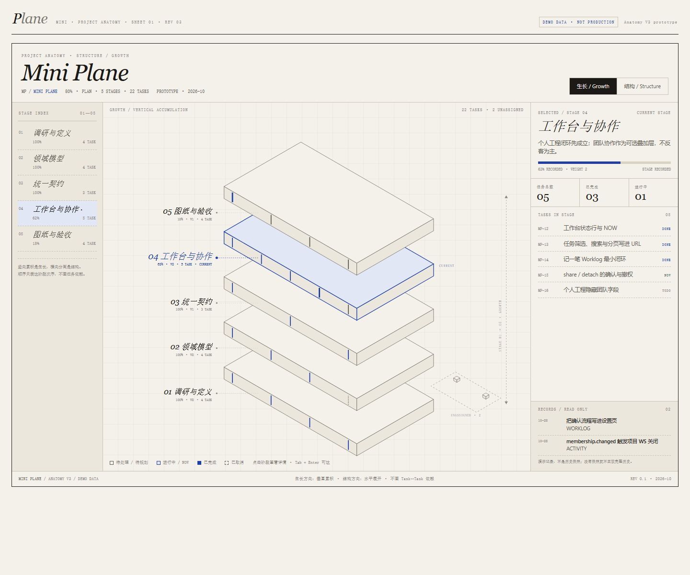
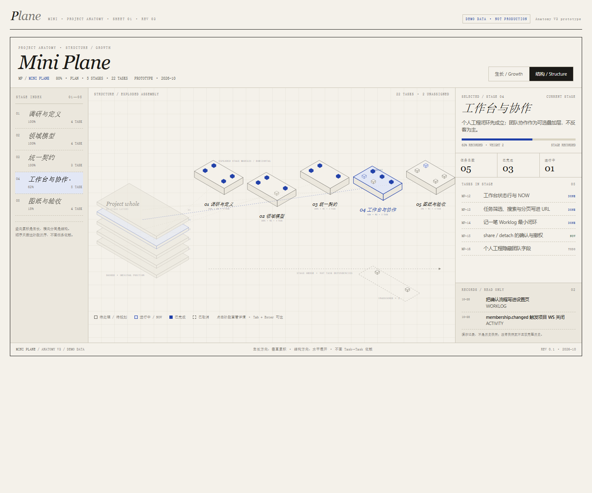
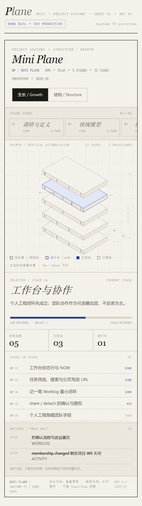
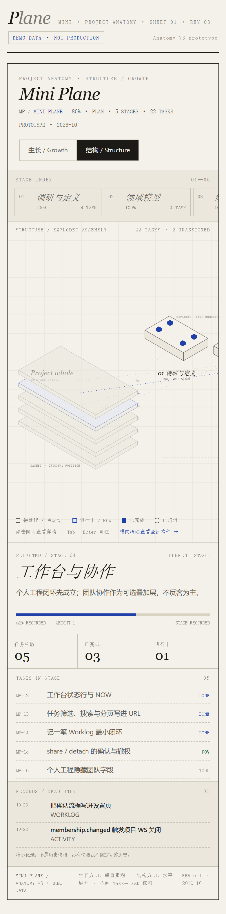

# Anatomy V3 · 生长视图 / 结构视图

> 状态：**Phase 2 样稿方向已确认（结构 ghost + 爆炸模块；生长大图 + 滑轨），
> 进入 Phase 3 桌面生产接入；手机端暂缓，结构图届时改纵向滚动。**
> 分支：`feat/anatomy-v3` · 日期：2026-10-28

## Rev.2 改了什么

- **结构视图**：从“共同基座/包络线”改为 **左侧 ghost 整体堆叠 + 右侧爆炸 Stage 模块**，
  每个模块用虚线回连到整体中的原始层位，直接表达“局部从整体哪里拆出来”；
- **生长视图**：整体放大约 30%，画布超过视口时用纵向滑轨上下查看；
- **手机端**：结构图保留横向滚动并显示“横向滑动查看全部构件 →”，生长图隐藏长标签。

## 先看什么

1. [高保真原型](prototype.html) —— 直接用浏览器打开；桌面/手机都可看。
2. [Phase 1 现状审查](PHASE1_AUDIT.md) —— 哪些复用、哪些重构、发现的数据完整性问题。
3. [技术 Preflight](PREFLIGHT.md) —— 检索台账、技术路线与已知坑。
4. [Phase 2 原型记录](PHASE2_PROTOTYPE.md) —— 设计决策、验证结果、待确认点。

## 原型截图

| 生长视图（桌面，放大后） | 结构视图（桌面，整体 ghost + 爆炸模块） |
|---|---|
|  |  |
| **生长视图（390px）** | **结构视图（390px，初始视口 + 滑动提示）** |
|  |  |

> 截图采集日期 2026-10-28；演示数据，不接生产 API。

## 当前边界

- `prototype.html` 仍使用演示数据，不连接 API、不改数据库；生产接入从本轮 Phase 3 开始；
- 不做 Task 依赖箭头，不生成按日历史回放；
- 桌面版优先；手机结构图改为纵向滚动，等桌面稳定后实现；
- 生产接入前先解决 >100 Task 分页导致的构件缺失（见 Phase 1 审计 §2.2）；
- 生产接入顺序：全量 Task 数据边界 → 双视图状态/URL → 布局纯函数 → SVG 模块 →
  三栏详情/索引 → 测试/文档。

## 下一步

Phase 3（桌面）：先修全量 Task 数据边界，再把样稿拆成 `layoutGrowth` / `layoutStructure`
纯函数，接入生产 `AnatomyPlate`；手机端保持可用即可，纵向结构视图留待桌面稳定后实现。
