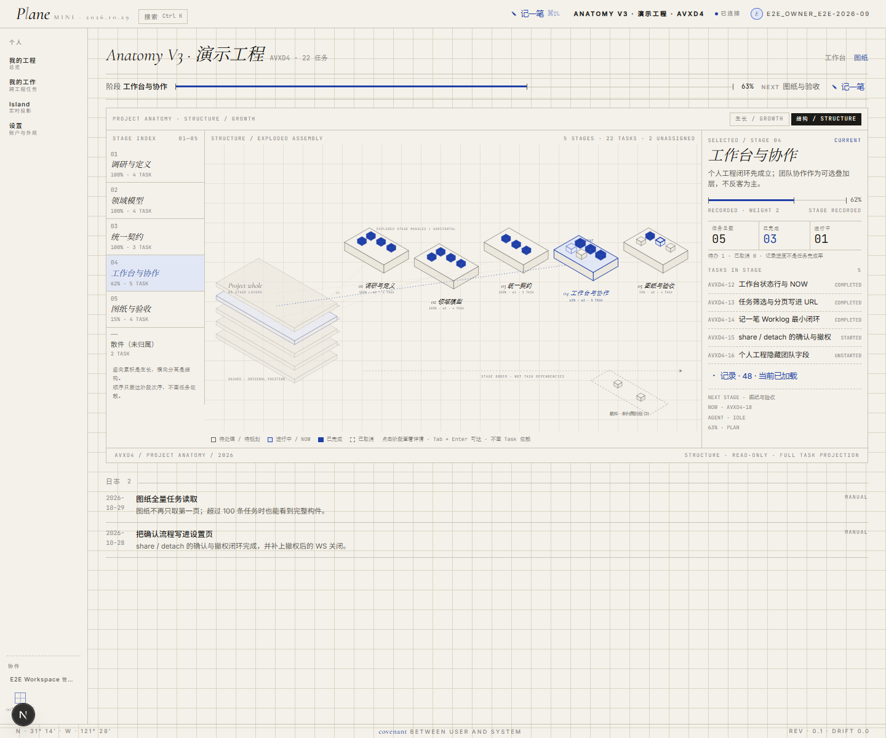

# Anatomy V3 · 生长视图 / 结构视图

> 状态：**Phase 3 桌面生产接入完成（2026-10-29）；等待视觉验收。手机端按用户要求暂缓。**
> 分支：`feat/anatomy-v3` · 生产代码已切换为 V3，V2 仅保留历史文档。

## 先看什么

1. [Phase 3 生产接入记录](PHASE3_REPORT.md) —— 全量 Task、双视图布局、三栏界面、验证结果。
2. [高保真原型](prototype.html) —— 独立演示数据，不接 API；保留作构图参考。
3. [Phase 1 现状审查](PHASE1_AUDIT.md) —— 复用/重构边界与数据完整性问题。
4. [Phase 2 原型记录](PHASE2_PROTOTYPE.md) —— 结构 ghost + 爆炸模块、生长大图 + 滑轨的决策过程。
5. [技术 Preflight](PREFLIGHT.md) —— 检索台账、技术路线与已知坑。

## 生产截图（2026-10-29）

| 生长视图（桌面，大图 + 纵向滑轨） | 结构视图（桌面，整体 ghost + 爆炸模块） |
|---|---|
|  |  |

> 真实运行态截图，演示项目 AVXD4（5 Stage / 22 Task，演示数据）。

## 当前实现

- **生长视图**：旧 Stage 在下、新 Stage 在上；Task 以前缘密度线表达真实状态；
  画布超过 `70vh` 时出现纵向滑轨；
- **结构视图**：左侧 ghost 整体堆叠 + 右侧水平爆炸模块；虚线回连原始层位，
  只表示空间位置，不表示任务依赖；
- **索引 / 详情**：桌面固定左右栏；选中 Stage 在两视图间共享；
- **URL**：`?view=plate&mode=structure&stage=<id>`；兼容 V2 的 `expand=1`；
- **数据**：图纸读取全量 Task（分页循环 + 去重，5000 条上限），
  未取完时显式标注 partial，不假装完整；
- **视觉上限**：生长每 Stage 最多 14 条任务线、结构最多 12 个立方体，
  只裁图不裁数据；详情列出全部 Task。

## 当前边界

- 手机端暂缓：AppShell 在 390px 仍有全站横向溢出；结构图的纵向展开留到桌面稳定后实现；
- 记录区仍是当前已加载的 Worklog/Activity，不是完整历史，也没有旧结构回放；
- 结构视图模块很多（viewBox > 1600）时横向滚动，暂不自动分行；
- 主 README 的图纸截图/文案仍待视觉验收后替换。

## 下一步

1. 用户确认桌面双视图视觉与信息密度；
2. 手机端纵向结构视图；
3. 主 README 与项目记录同步；
4. 大 Stage/Task 项目的真实性能复测。
